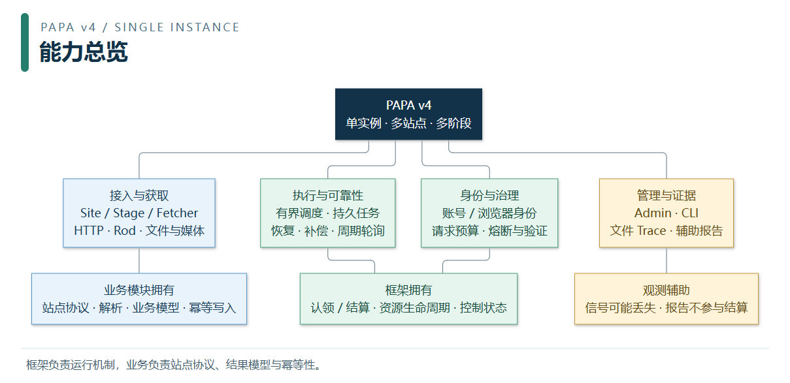

# Papa - 高性能爬虫框架

> 基于 Go 的爬虫框架，内置**浏览器自动化（Rod）**与**静态 HTML 抓取（htmlfetch）**双引擎：浏览器池、多阶段工作池、任务持久化与恢复、M3U8/文件下载、失败重投/启动恢复/周期轮询治理队列、Web 监控。框架不再内置通用 cron 调度器。
> **运行观测（obs）**：框架级结构化事件流（`logs/events.jsonl`）+ 人读报告 / 机读 JSON / AI 排查细则（`papa report`），见 [OBSERVABILITY.md](operations/OBSERVABILITY.md)。
> **运行治理**：默认关闭的同站请求预算/AutoThrottle、单实例资源放行、站点账号池与代理健康；OA 持久覆盖优先于文件显式字段，见 [RUNTIME_CONTROL.md](runtime/RUNTIME_CONTROL.md)。



从 [Papa 六图介绍](architecture/PAPA_OVERVIEW.md) 开始：能力总览 → 组件关系 → 动态数据流 → 背压与恢复 → 观测证据 → 关停排空。图片附有 SVG 和 Mermaid 源码，可放大或用于介绍。

要看核心引擎内部，进入 [Engine 组件、运行与算法](architecture/ENGINE_GUIDE.md)：内部组件 → 调度与背压 → 尝试与结算，附三张专图和算法公式。

## 适用版本与文档边界

本目录各主题手册及 `package_structure/` 说明当前工作区的 **Papa v4 独立版本**；不提供 v3 及更早版本的 API、配置、旧表转换或工程布局兼容。源码仓库中的 `history/` 集中保存注明适用阶段的审查、验证、设计、计划和变更记录，不随 CLI 分发，也不覆盖当前手册。历史测试结果只证明当次代码和环境，不能当作当前版本重新验收的证据。

Trace 只写文件，配置 `crawler.trace.mode` 为 `off/errors/all`，默认 `errors`，默认保留七天；不建 Trace 表、不读取或迁移 SQL Trace，也没有后台主动追踪按钮。异常尝试包括失败、panic 和显式 Fail/Warn；记录不代表任务当前终态。配置见 [CORE_CONFIG.md](configuration/CORE_CONFIG.md)，查询语义见 [MONITOR.md](operations/MONITOR.md)。任务、账号、熔断等业务运行状态仍由 MySQL 持久化，不能因为 Trace 改文件而省略它们的迁移。

运行关联以 [静态组件图与动态数据流图](architecture/ARCHITECTURE_DIAGRAMS.md) 为入口：在线 obs 仅接收有限信号，分析并输出报告，不查业务库或调用业务分析回调；显式离线 `papa report` 的扫描、可选查库与扩展另见 [OBSERVABILITY.md](operations/OBSERVABILITY.md)。

## 快速开始

```bash
go install github.com/ydtg1993/papa/v4/cmd/papa@latest
papa new mycrawler --replace /path/to/papa   # 或外部 go run github.com/ydtg1993/papa/v4/cmd/papa@latest new mycrawler
cd mycrawler && go mod tidy
```

1. 把 `configs/config.yaml` 的 `db.dsn` 指向你的 MySQL（`configs/config.yaml.example` 是进版本库的范本，
   照它抄一份自己的 `config.yaml`）。
2. **`papa migrate` 建表** —— 在项目目录下跑（它自己读 `configs/config.yaml`）。检测到这是业务
   项目时，它会转交项目自己的迁移入口，框架表与 `models` 包里的业务模型一起建。
   之后每新开一个带表的开关（`server.operation_log` / `task_flow.enabled`）都要**再跑一次**，对应表跟着开关走。
3. 写 fetcher（实现 `papa.Fetcher`）；**站点与阶段声明写在 `internal/sites/<站名>.go`**（物理并发/队列、间隔/重试默认值/
   入口开关在那儿声明；runtime/OA 可覆盖有效并发与固定间隔），`internal/app/run.go` 通过 `app.RegisterSites(papa.Sites()...)`
   统一注册 —— 加一个站只加文件。起始任务由 fetcher 自己实现 `SubmitEntries(engine, site)` 提交
   （见 [FETCHER_WRITING_GUIDE.md](guides/FETCHER_WRITING_GUIDE.md) 1.1）。
4. 加数据模型写`internal/models/` 包（`internal/models/models.go` 里登记建表清单）；后台（`/monitor`）
   要加表格页 / 自定义页 / 自己的接口，改 `internal/monitor/` 包 ——
   `internal/app/run.go` 通过 `monitor.Register(app)` 接入（分层与用法见 [MONITOR.md](operations/MONITOR.md) 第 5 节）。
5. `go run .`（配置路径默认 `configs/config.yaml`，要用别处就 `go run . --config=./config.yaml`）。

启动时**不会**自动建表 —— 迁移是显式的一步，所以本地和生产跑的是同一条命令。
当前 v4 建表清单包含运行策略、账号池管理、`crawler_browser_profiles` 与 `crawler_browser_identity_bindings`；这些表不因关闭相应控制器而从基础清单移除。浏览器身份两表不含凭据，创建档案不自动启用绑定。
显式迁移在调用 GORM `AutoMigrate` 前先检查任务 schema；旧列、旧索引或缺失 v4 身份的数据会被拒绝，需使用独立 v4 数据库，不会自动回填旧任务。通过检查后，迁移创建或更新当前模型；GORM 也可能调整列类型，不能将其理解为“只新增”。重复执行支持当前 v4 schema，仍需审查变更 SQL；迁移不负责删除旧列或任意破坏性数据转换。

> **在项目目录里 `papa migrate` 与 `make migrate` 等价**：CLI 是独立编译的进程，看不到你在
> `main.go` / `models.Models()` 里注册的模型，所以它在业务项目里会把迁移**转交**给项目自己
> （`go run . -migrate` → `App.Migrate()`），两边都建。不在业务项目里跑时它只建框架自带的表。
> 脚手架刚生成的项目没有业务表（框架任务表不存采集结果，抓到的结果要在 `internal/models/` 里建业务表来落），
> 所以起步阶段两条命令等价。判据与细则见 [CORE_CONFIG.md](configuration/CORE_CONFIG.md) 第 2 节。

新项目根入口只转交 `internal/app.Run`；应用导航在 `docs/README.md`，本套框架手册复制到 `docs/framework/`，并保留各主题目录与 `package_structure/` 层级。`check` / `upgrade` 只支持当前 v4 工程布局；`upgrade` 刷新框架副本并检查项目，不转换旧版业务代码或数据库。

## 目录与阅读路径

```text
docs/
├── README.md             # 当前文档总入口
├── embed.go              # CLI 分发白名单
├── architecture/         # 架构图、边界、框架开发与验证
├── assets/diagrams/      # 图册源码、SVG、PNG 与生成校验清单
├── configuration/        # 配置字典、显式建表、资源预算
├── guides/               # Fetcher、抓取工具、业务数据落地
├── accounts/             # 账号接入、认证运行、浏览器身份
├── runtime/              # 时间、任务流、三队列、熔断与治理
├── operations/           # CLI、监控后台、观测与报告
├── package_structure/    # 包职责说明书，App 并入 Internal
└── history/              # 仅源码仓库保留，不随 CLI 分发
    ├── README.md
    ├── reviews/          # 审查、实施结果、验证与阶段画像
    ├── designs/          # 设计方案与适用状态
    ├── plans/            # 施工步骤，不作为完成证明
    └── changes.md        # 跨阶段历史变更记录
```

| 想做什么 | 分类入口 | 建议阅读顺序 |
| --- | --- | --- |
| 先看全局，或修改框架 | [架构与开发](architecture/README.md) | 架构图 → 架构规则 → 开发验证 |
| 理解核心引擎及算法 | [Engine 专篇](architecture/ENGINE_GUIDE.md) | 内部组件 → 有限工作集 → 执行结算 → 算法与边界 |
| 配参数、建表、控制资源 | [配置与预算](configuration/README.md) | 配置字典 → 单实例资源预算 |
| 接一个站点并保存结果 | [抓取接入](guides/README.md) | Fetcher → 数据落地 → 可选抓取工具 |
| 接登录、账号池与稳定身份 | [账号与身份](accounts/README.md) | 账号运行 → OA 接入 → 浏览器身份 |
| 控制任务运行与故障恢复 | [运行调度](runtime/README.md) | 任务时间/任务流 → 三队列 → 熔断与治理 |
| 用命令、后台或排查报告 | [运维观测](operations/README.md) | CLI → 后台 → 在线/离线观测 |
| 查各包职责、状态与依赖 | [目录说明书](package_structure/README.md) | 总索引 → 根目录/Admin/Engine/Internal/Pkg/Obs/Cmd 分册 |

新手从本页的快速开始进入 [Fetcher 编写](guides/FETCHER_WRITING_GUIDE.md)，再读 [数据落地](guides/DATA_LANDING_GUIDE.md)。先看全局可直接打开 [两张架构图](architecture/ARCHITECTURE_DIAGRAMS.md)。历史追溯在源码仓库的 `docs/history/README.md` 进入；分发副本不包含该目录。

## 文档维护与分发

- 每份当前手册只保留一个主题归属；主题 README 负责导航，不复制配置/API 正文。包与文件职责统一写入 `package_structure/`。
- 新增手册同步主题入口和必要的总导航；新主题目录或图像资源同时更新 `embed.go` 白名单及文档分发测试。图册更新见 [维护说明](architecture/DIAGRAM_ASSETS.md)。历史设计和测试结论不得混入当前用法。
- 手册移动时同步相对链接、源码中的文档指针、CLI 模板和技能文档映射。所有当前手册的本地链接必须在分发副本内可解析。
- `papa new/upgrade` 保留上述当前目录层级。`upgrade --write` 只刷新当前框架拥有的路径，不自动删除已有项目的旧路径文档或用户笔记；旧副本由项目维护者核对后处理，新导航只指向当前路径。

## 注意事项

- 遵守目标网站 robots.txt 与法律法规，合理设置抓取频率。
- 生产环境建议 `headless: true`，按负载调 `pool_size`（浏览器**全局**并发上限，`browser.enable: true` 时必填且 > 0；改需重启）/ 数据库连接池。
- 自动合并 MP4 需系统安装 ffmpeg。

## License

基于 [MIT License](https://github.com/ydtg1993/papa/LICENSE.txt) 开源。
