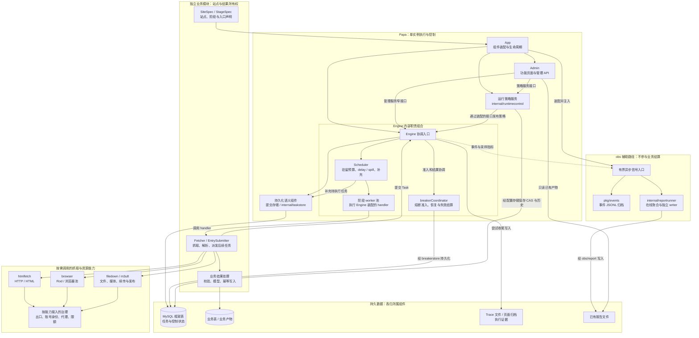
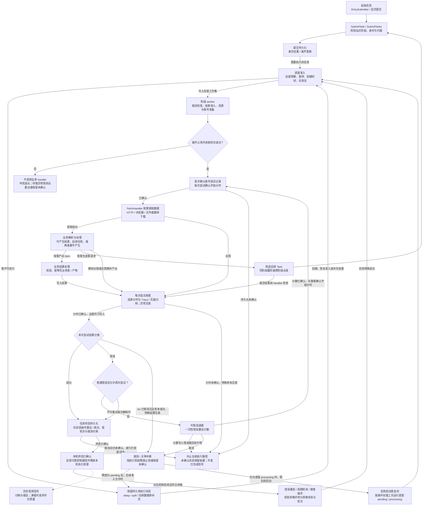

# Papa 架构图解：组件与任务数据流

核心引擎内部组件、调度背压、执行结算和算法公式另见 [Engine 专篇](ENGINE_GUIDE.md)。

> 面向：需要先看懂框架整体，再定位具体代码或接入站点的开发者。
> 配套：[目录说明书](../package_structure/README.md) · [架构规则](ARCHITECTURE.md) · [Fetcher 契约](../guides/FETCHER_WRITING_GUIDE.md)。
> 适用版本：当前工作区的独立 Papa v4；图中 Trace 为文件证据，在线 obs 为有界信号旁路，不能套用历史 SQL Trace 或统一监控中心方案。

Papa 是**单实例、单进程内模块化**的爬虫框架。多个站点、多个阶段由进程内 worker 并发执行；下图不包含分布式 Master/Worker。独立业务模块是代码职责边界，可以与框架运行在同一个进程中。

## 1. 通用爬虫名称如何对应 Papa

初次阅读可先看 [六图介绍](PAPA_OVERVIEW.md)，其中包含可直接查看的组件图、动态数据流 PNG，以及 SVG/图源。本页继续保留更详细的 Mermaid 分支与异常契约，两者按同一实现维护。

| 通用名称 | Papa 中的实际对应 | 职责边界 |
| --- | --- | --- |
| Engine | `engine.Engine` | 协调任务提交、调度、执行和结算，通过各自组件维护状态 |
| Scheduler | Engine 调度组件、`engine/internal/scheduler`、`internal/workerpool` | 驻留预算、阶段池、延迟/溢出及持续数据库补充；不是另一个独立调度服务 |
| Spider | 业务的 `SiteSpec` / `StageSpec`、`Fetcher`，可选 `EntrySubmitter` | 声明站点与阶段；提交入口；在 `FetchHandler` 中抓取、解析、保存结果和提交后续任务 |
| Downloader | `pkg/htmlfetch`、`pkg/browser`，以及 `pkg/middleware/filedown` / `m3u8` | 前两者获取网页/浏览器响应；后两者下载文件/媒体。按需选择，不是每个任务都必须经过全部组件 |
| Middlewares | 网络出口、请求治理、账号/身份、代理，以及下载器资源能力 | 分散在各自能力的调用边界；Papa 没有要求所有请求依次穿过的统一 Spider Middleware 链 |
| Pipeline / Item | 业务自己的解析结果处理、校验、模型及写入逻辑 | 没有统一的 `yield Item` 或框架自动 Item Pipeline；任务表不保存采集结果 |
| Request | 提交给 Engine 的 `Task`，以及 handler 内实际发出的网络请求 | 调度单位是 Task。一个 Task 可以发多个 HTTP 请求，也可以不访问网络；URL 不是唯一的任务身份来源 |

## 2. 静态组件图：系统由什么组成

实线表示主要调用、装配或存储关系；虚线表示观测信号。**这不是 Go import 图**，也不表示任何组件可以拿到另一个组件的全部内部状态。具体接口和允许依赖以目录说明书为准。

图中业务表与框架表按**数据所有权**分开画，不要求部署两个数据库。业务可以调用框架公开的数据写入辅助接口，但业务模型、唯一键与写入时机仍由业务负责。

Scheduler 是 Engine 内部的职责组合：调度状态、驻留令牌与存储补充协作完成背压。数据库中的待处理积压不等于内存中驻留了全部任务。熔断和任务结算走可靠控制路径；在线 obs 不持业务 DB、不调用业务分析回调，不用报告是否成功来决定任务成败。

图中把调用链压缩为职责节点：worker 池本身不认识业务 Fetcher，它运行 Engine 装配的阶段 handler；`breakerCoordinator` 属于 Engine，运行策略服务则是独立组件。策略服务到 Engine 的箭头表示通过 App 装配的接口/适配接线生效，**不是服务导入 Engine**。请求治理也是按能力接入，不能把 `Guards` 理解为一个统一全功能中间件对象，或认为任意自建 HTTP 客户端都会自动受管。

| 依赖约束 | 不能从运行图推导出的关系 |
| --- | --- |
| App 装配 Engine、Admin、运行策略与在线观测 | Admin 不反向依赖 App；独立服务不持完整 App/Engine |
| Engine 使用 `engine/internal/*` 和存储语义 | `engine/internal/*` 不反引 Engine；`internal/taskstore` 不依赖 Engine/HTTP |
| `internal/runtimecontrol` 通过窄接口工作 | 不直接导入 Engine、App 或 Admin |
| 在线 Runner 使用值信号和自有文件资源 | 不读取业务 DB、不执行离线分析回调；Admin 不通过在线 Runner 请求生成报告 |

## 3. 动态数据流图：一个任务如何走完一圈

这是**持久化 Task 的主要路径**，省略内部锁与每个 SQL 重试。`Fetcher` 同时承担“调用获取能力”和“解析响应”的业务职责；两者在图中展开，以显示请求、响应、结果和后续任务如何关联。常规 App 启动先完成 `InitBreakerRuntime` 的保护恢复及持久确认，再 `ApplyRegisterStage` 开始入口/队列执行；初始化失败不会继续提交入口。非持久化内部任务不在本图范围内。

### 阅读时要守住的四个区别

1. **业务结果与任务终态是两件事。** Item 写入和框架终态不是一个自动跨表事务；进程可能在业务提交后、任务终态确认前退出，业务写入必须幂等。`FetchHandler` 返回成功后，终态写入重试不会再次调用业务 handler。
2. **产出不是自动分发协议。** 图中 Item / 新 Task 是业务可选分支，不是互斥选择，也不代表后台异步执行。`Child → Submit` 是子任务进入同一提交路径，`Child → Finish` 是当前 handler 处理提交返回值后进入本次尝试收尾，不是自动分叉或自动等待子任务。子任务可能先于父任务终态执行，顺序约束须由任务流/业务契约保证。handler 自己检查解析、写入和提交结果，再返回 `nil` 或 `error`；Papa 不解释 `yield Item/Request`。提交失败/去重不会无条件入队；批量提交报错也不能推定整批回滚。
3. **取消不等于普通失败重试。** 认领前已取消就不执行 handler；已经成功的业务会在有限窗口内确认计时与终态。未完成、未确认的状态要保留恢复依据。关停排空以实际在途工作退出为准，超时不得提前销毁共享依赖；图中的恢复边是后续启动/治理行为，不是关停时立即重跑。
4. **重试、重投、轮询不同。** 退避重试属于本次认领内的 handler 尝试；错误队列重投和周期轮询须先完成各自持久化条件转换、再入调度。重复提交、任务流门槛、熔断保护可能阻止立即执行；不能把图中的回环理解成无条件重复抓取。

### 图中异常分支的准确口径

| 场景 | 当前实现 |
| --- | --- |
| 准入等待后才发生暂停或取消 | worker 在认领前复查；不应调用 handler。未认领的 pending 可由调度持续补充，持续补充不依赖启动恢复开关 |
| 认领成功 | 还需读取已认领轮次、保存账号尝试记录（如适用），并确认开始计时；不能仅凭 Claim 成功就认为业务已调用 |
| 普通可重试业务错误 | 未取消且次数未耗尽时，可取消退避，再**一次性**增加 retry。计数写入错误/回执不明就退出并保留未确认，不能循环加法写入或继续 handler |
| 计时写入失败 | 重试的是计时状态操作。最终仍无法确认时不把它当业务失败再执行 handler；普通取消路径按阶段释放认领或保留未确认 |
| 终态写入失败或确认丢失 | `Complete` 按轮次写入并可读取当前终态确认丢失回执。普通存储错误留在 worker 中退避；行消失/版本变化立即退出，取消终止等待；不是所有错误都无限重试 |
| 业务已成功，但取消与收尾并发 | 结束计时、终态各自使用 `ConfirmSuccess`，取消时各有最多 2 秒确认窗口；不是整个任务共用 2 秒，也不是无限脱离取消 |
| ctx 已取消且 handler 返回错误 | 普通路径释放认领；**熔断选中样本**若返回真实业务错误（包括与取消组合的错误），仍需有限窗口持久失败。纯取消不作为健康失败证据；迟到成功不证明站点恢复 |
| handler panic / 不可重试 / 账号失败 / 补偿策略错误 | 不进入普通同次尝试重试循环；按相应结算路径处理。panic 的步骤与归档先收尾，再由阶段 handler 尝试落失败；取消和未确认状态仍按实际分支处理 |
| 熔断样本的最终失败 | 先保存可靠失败意图，再处理计时和终态，后续控制结算可接续；这条存储路径不经过 obs。终态已确认不等于熔断整个恢复事务或整个 App 已排空 |
| processing 与 pending 恢复 | 持续补充只查符合条件的 pending；上次运行遗留 processing 需要启用启动恢复并满足筛选条件。未确认记录可能已经是终态，必须按持久状态核对，不能一概重跑 |

观测虚线只表示一个典型信号位置；App/Engine 还会发出运行开始、认领、重试及采样指标。默认 App 接线在 `obs.events.enabled` 开启时建立信号入口，并给在线 Runner 注入该入口；后台只读报告文件。转发、归档和报告各有固定消费者/有界工作集，但 App 收尾**共享同一个最长 2 秒 deadline**，不是每路各等 2 秒。故障、满载或退出报告缺失不改变任务结算与熔断恢复；共享 CPU/内存/磁盘的物理影响仍存在。

Trace/页面归档是尝试 `defer` 中执行的独立证据写入路径，**不经过 obs 异步队列**，也不自动享有 obs 的 2 秒收尾预算。它们不承担恢复日志职责，不能把“obs 旁路”外推为所有日志/证据 I/O 都不会影响 worker。在线报告也不包含全部离线分析能力：CLI 显式离线分析可读取归档或配置的数据库输入，但不在爬虫执行/关停链中运行。

本次源码核对落点：`internal/app/lifecycle.go`、`bootstrap.go`、`observation.go`、`reports.go`；`engine/stage.go`、`attempt_execution.go`、`attempt_persistence.go`、`persistence.go`、`scheduler_refill.go`、`recoverqueue.go`、`breaker_runtime.go`；`engine/internal/execution/{state,settlement}.go`、`internal/taskstore/store.go`；`pkg/events/emitter.go`、`admin/reports/handler.go`。这些路径相对框架源码根目录，便于维护时追溯，不是业务项目中的相对文件路径。

## 4. 从图定位实现

| 图中的职责 | 进一步阅读 |
| --- | --- |
| App 装配、启动失败清理与关停排空 | [Internal 分册](../package_structure/INTERNAL_STRUCTURE.md) |
| 提交、Scheduler、worker 协调、认领与终态 | [Engine 分册](../package_structure/ENGINE_STRUCTURE.md) |
| Spider / Fetcher、入口与后续 Task | [Fetcher 手册](../guides/FETCHER_WRITING_GUIDE.md) |
| 业务 Pipeline / Item 落地 | [数据落地](../guides/DATA_LANDING_GUIDE.md)、[采集工具](../guides/CRAWL_TOOLKIT.md) |
| HTTP、浏览器、下载与资源组件 | [Pkg 分册](../package_structure/PKG_STRUCTURE.md)、[资源预算](../configuration/RESOURCE_BUDGETS.md) |
| 重投、启动恢复与周期轮询 | [错误队列](../runtime/ERROR_QUEUE.md)、[恢复队列](../runtime/RECOVER_QUEUE.md)、[轮询队列](../runtime/REPEAT_QUEUE.md) |
| 任务流门槛、熔断与运行治理 | [任务流](../runtime/TASK_FLOW.md)、[熔断](../runtime/BREAKER.md)、[运行治理](../runtime/RUNTIME_CONTROL.md) |
| 观测信号、离线分析及报告产物 | [Obs 分册](../package_structure/OBS_STRUCTURE.md)、[观测手册](../operations/OBSERVABILITY.md) |
| Admin 窄接口与前后端功能归属 | [Admin 分册](../package_structure/ADMIN_STRUCTURE.md) |

修改组件职责、任务准入/结算路径或观测边界时，应同时检查这两张图与对应分册；不能只改目录树，也不能把设计中的组件画成当前已实现能力。
