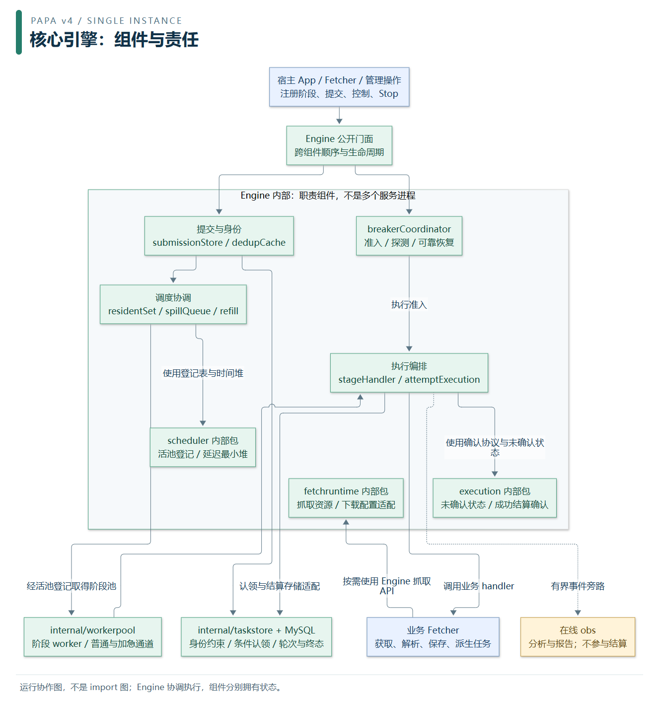
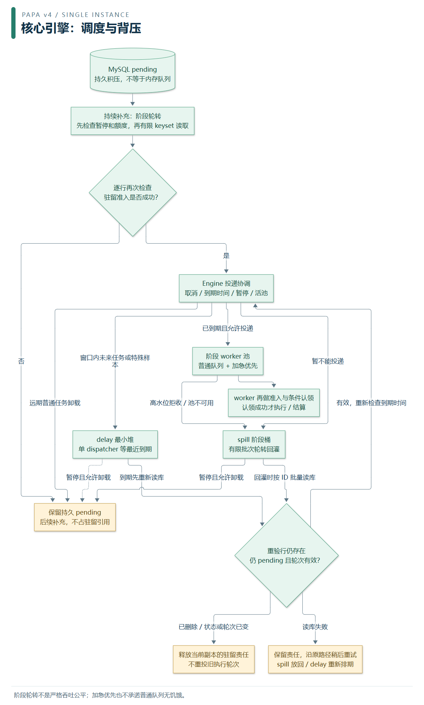
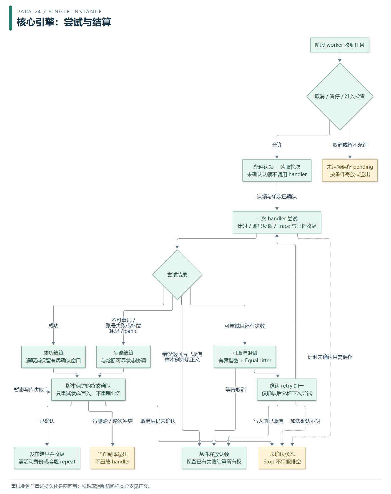

# Papa 核心引擎：组件、运行与算法

> 面向：想理解 Papa 如何调度任务、控制积压并可靠结算的开发者。适用当前独立 v4、单实例。
> 返回 [文档导航](../README.md) · [全框架六图](PAPA_OVERVIEW.md) · [Engine 文件职责索引](../package_structure/ENGINE_STRUCTURE.md)。

Engine 是**持久任务的执行编排器**。它把“已接受的任务”推进到可执行状态，协调阶段 worker、暂停/熔断、抓取资源和持久化确认。业务 Fetcher 决定请求什么、怎样解析、保存什么结果，以及是否派生新任务。一个 Task 不等于一次 HTTP 请求。

阅读顺序：先看组件归属，再看任务如何进入有限工作集，最后区分业务重试与持久化结算。算法表与后面的公式解释每一步为什么这样做；具体配置以配置手册为准。

## 1. 引擎内部由什么组成



[SVG 放大图](../assets/diagrams/07-engine-components.svg) · [Mermaid 图源](../assets/diagrams/07-engine-components.mmd)

这是主要运行关系，不是完整调用图或 Go import 图。Engine 的部分职责是同包组件，部分是真正的独立包；图中的分框不代表已经拆成多个 Go 包。熔断持久化、任务流等旁支未逐条画出。调度投递与到期后的 SQL 重验由 Engine 适配层完成，scheduler 只拥有登记表和堆；execution 的确认协议接收调用方提供的写入操作，不直接接管所有任务 SQL。

| 组件 | 拥有什么 | 解决的问题 |
| --- | --- | --- |
| Engine 门面 | 组件装配引用、跨组件顺序、取消与等待组 | 把提交、执行、控制和停止接成一致协议 |
| submissionStore / dedupCache | 提交存储操作、身份 LRU | 重复提交与批量部分成功；缓存不替代数据库约束 |
| residentSet / spillQueue / refill | 驻留责任、溢出成员与阶段游标 | 有限内存承接持续数据库积压 |
| `engine/internal/scheduler` | 活池登记、停止位、延迟堆与唤醒 | 阶段池懒建/回收、按时间投递；不拥有 SQL |
| `internal/workerpool` | worker、普通/加急通道、暂停闸门 | 执行阶段任务并真实排空；不决定任务终态 |
| stageHandler / attemptExecution | 认领后的执行顺序、一次尝试的资源与证据收尾 | 重试、panic、取消、成功/失败路径衔接 |
| `engine/internal/execution` | 未确认持久状态、确认重试、取消后成功确认窗口 | 区分“业务完成”与“数据库已确认” |
| `internal/taskstore` | 认领/释放/终态/轮次等条件 SQL | 防止旧轮次、重复投递和并发管理操作覆盖当前状态 |
| breakerCoordinator | 熔断准入、失败结算、探测/样本轮次及恢复证据 | 故障保护与可靠恢复；obs 报告不是状态来源，breakerstore 的可靠快照参与恢复 |
| `engine/internal/fetchruntime` | 抓取资源及下载配置适配 | 复用浏览器、HTTP、账号、身份与下载组件 |

`pkg/governance` 另行拥有请求预算和资源许可；`pkg/account`、浏览器池、下载器各自拥有领域状态。App 负责装配和外层生命周期，obs 只接收事件并分析报告，均不应变成 Engine 内部状态的第二个拥有者。

## 2. 调度：为什么积压多时不必全部装进内存



[SVG 放大图](../assets/diagrams/08-engine-scheduling.svg) · [Mermaid 图源](../assets/diagrams/08-engine-scheduling.mmd)

图中的“投递协调”汇总 Engine 多个函数的逻辑分支，不代表单一方法或所有路径相同的锁顺序。图从已持久化 pending 的补充路径展开，并汇合 delay/spill 回灌路径；初次提交可以直接进入调度，不必先等一次 refill。是否接受提交、是否准入内存、是否认领执行是三个不同判断。未持久任务不能套用“留在 DB 就不会丢”的保证。

1. **持久化与身份**：框架按站点、阶段及资源身份处理提交。已入库任务即使暂时无法进入 worker，也有数据库记录作为后续补充依据。
2. **非阻塞驻留准入**：同时检查全局、站点、阶段三个数量预算。worker 派生子任务时不等待自己的执行槽位。`SubmitTask` 无驻留容量时，带既有 ID 或携带 Meta 的 repeatable 输入会在提交准备前返回 `ErrSchedulerCapacity`；其他新任务仍可先完成持久化，再由持续补充承接，不能一概说“未入库就报错”。内部投递无法接纳无 ID 引用时也返回容量错误。
3. **持续补充**：按注册阶段轮转，跳过暂停/无容量阶段；每阶段使用 `id > cursor ORDER BY id LIMIT batch`，只读 pending、补偿资格允许且 `not_before` 在预取窗口内的行。不使用越来越大的 OFFSET。
4. **时间与满载**：普通远期任务超出 DelayWindow 时不驻留；窗口内未来任务及需保留进程内许可的特殊样本交 delay 最小堆。delay 到期重读单行，spill 回灌批量重读；行已删除、非 pending 或 Repeat/Reprocess 已变就放弃当前副本，读失败保留责任稍后重试，有效行重新核对 NotBefore 后投递或再延迟。暂不可投递或达到队列高水位时由 spill 协调。已持久、未认领且不承担特殊熔断样本责任的引用，可按条件卸载，释放驻留容量。
5. **执行前再次确认**：内存投递不是执行权。worker 经过暂停、熔断和运行治理准入后，以条件更新认领当前轮次；未认领成功不调用业务。

驻留责任覆盖排队、执行、spill、delay 及已取出但尚未交接的批次；一次 spill/refill 回灌使用同一个 100ms 尝试期限，先处理 spill 再补充 pending，耗尽本轮时间就等后续唤醒。它不是严格的 100ms 方法耗时保证。`refillMu` 是串行化这轮读库/回灌的独立锁；不能宣称“所有引擎锁均不跨 SQL”。

默认驻留上限为全局 4096、每站 2048、每阶段 1024；补充批次 64、延迟预取窗口 1 分钟。它们限制任务引用数量，**不是进程 RSS 上限**。大 Meta、浏览器和下载缓冲还需要各自预算。设置必须在调度开始前按声明期契约完成，见 [资源预算](../configuration/RESOURCE_BUDGETS.md)。

阶段轮转缓解一个阶段长期独占补充机会，但不是加权公平队列，也不承诺相同吞吐。spill 每轮选择阶段桶并取有限批次；worker 内部的加急通道优先，持续加急可能挤压普通任务，不能把“跨阶段轮转”误解为所有任务严格公平。

## 3. 执行：重试业务不等于重试写库



[SVG 放大图](../assets/diagrams/09-engine-execution.svg) · [Mermaid 图源](../assets/diagrams/09-engine-execution.mmd)

主干顺序为：**准入 → 条件认领 → 一次 handler 尝试及收尾 → 判断结果 → 重试或结算 → 发布结果/释放资源**。图省略部分冲突、账号与特殊样本分支，不能据此把所有错误都走一条释放路径。

| 场景 | 当前行为 |
| --- | --- |
| 尚未认领就收到取消 | 不运行 handler，持久行保留 pending |
| 可重试错误且还有尝试次数 | 先可取消退避，再确认 retry 加一，确认后执行下一次 handler |
| retry 加法确认不明 | 不重放加法、不继续 handler；保留未确认状态供后续处理 |
| handler 已成功，随后遇取消 | 成功确认可获得一次独立的有限收尾窗口；不能因取消而把已成功业务直接重跑 |
| 不可重试、账号尝试失败、带补偿策略、次数耗尽或 panic | 协调失败终态与熔断结算；panic 完成相关收尾后继续向 worker 传播 |
| 普通错误返回时 ctx 已取消，业务未成功 | 即使同时有业务错误，普通任务也按取消分支条件释放回 pending；panic 另走失败分支，已有失败结算所有权不能被覆盖 |
| 特殊熔断样本返回纯取消 | 仍按取消分支释放；与期限后返回真实业务错误区分 |
| 熔断样本在期限后返回真实业务错误 | 不当作纯取消抹掉；按样本结算规则保留失败证据 |
| 暂态状态写入失败 | 持有当前执行责任，仅重试认领/计时/终态操作；100ms 起、逐次翻倍、2s 封顶，不加抖动，直到确认或取消；retry 增量写不走此循环 |
| 行已删除或轮次冲突 | 状态重试直接返回冲突，不把每个失败都登记成“未知提交结果”；已存在的未确认责任仍需按协议处理 |
| 尝试计时或终态未确认 | 进入相应持久化确认/取消分支，不把“写库失败”当作重新调用 handler 的理由 |

Trace/页面归档在尝试收尾中执行，慢盘仍可能延长 worker 收尾；在线 obs 走有界事件旁路，满载可以丢信号，不决定任务结算。框架任务终态和业务结果保存并非自动跨表事务，崩溃后仍可能重跑，业务副作用必须幂等。

## 4. 当前引擎实际使用的算法

下表描述当前代码，不把历史优化候选算作已有能力。复杂度针对所列内存操作；SQL 成本取决于索引、资格过滤、数据量与执行计划。

| 算法/机制 | 核心做法 | 主要实现归属 | 成本与边界 |
| --- | --- | --- | --- |
| 身份去重 | 标准化站点/阶段/资源身份的 SHA-256；map + 双向链表 LRU；数据库身份约束兜底 | `core` 身份契约，`engine/task.go`、`dedup.go`、`submission_store.go` | LRU 查找/刷新平均 O(1)；散列成本随输入长度；显式无限缓存配置不受有限容量约束 |
| 驻留背压 | 一次准入同时检查全局/站点/阶段计数，状态转移保留责任，退出释放 | `scheduler_budget.go` | map 操作平均 O(1)；数量限额不限制单任务字节数 |
| 持续补充 | 阶段轮转 + 每阶段 ID keyset 游标 + 小批量窗口；读不足一批时游标归零重扫 | `scheduler_refill.go`、`internal/taskstore/pending.go` | 避免大 OFFSET；不是零扫描，也不是严格吞吐公平 |
| spill 回灌 | 按阶段分桶、轮次身份去重、稳定循环选桶、有限批次重验持久状态 | `scheduler_spill.go`、`spill.go` | 选桶会排序 K 个阶段键，约 O(K log K)；取批/压缩桶也有搬移成本 |
| 延迟调度 | 以到期时间为键的最小堆，单 dispatcher 等堆顶；新任务唤醒重算 | `engine/internal/scheduler/delay.go` | 入堆/出堆 O(log N)，看堆顶 O(1)；同到期时间不承诺 FIFO |
| 认领与结算 | 状态/轮次/补偿版本条件更新；冲突不覆盖；未确认与业务重跑分开 | `persistence.go`、`internal/taskstore`、`engine/internal/execution` | 保证所定义状态转换的原子性，不是业务副作用 exactly-once |
| 有界退避 | 先防溢出并封顶，再 Equal Jitter；等待由执行循环负责 | `retry_backoff.go`、`internal/backoff` | 常量计算；Handler 上限 60 秒，抖动不等于请求总数限额 |
| repeat 节拍 | 一条 MIN(epoch) 聚合；相同阶段/正上限合并站点条件；wake 合并 | `repeat_schedule_query.go`、`repeatpoll.go`、`dynticker.go` | 不缓存查询结果；全达上限仍可能扫描整个候选范围 |
| 故障保护与恢复 | 分类证据、准入、阶段探针、串行样本与轮次身份校验 | breakerCoordinator 及 `internal/breaker` | 是状态机协议，不是仅“失败数达到阈值就睡一下”；细则见 [熔断手册](../runtime/BREAKER.md) |

### 4.1 有界指数退避与抖动

下面公式适用于正 Backoff；直接 Engine API 传入非正 Backoff 时等待为零，声明层另行校验合法值。

Handler 的第一次重试取 `attempt = 1`，指数从 0 开始：

```text
E = min(Backoff × 2^(attempt−1), 60 秒)
实际等待 D ∈ [ceil(E/2), E]，按纳秒离散均匀采样
```

实现先比较上限再移位，不能先溢出再 min。首次执行不退避，最后一次失败后不多睡一次。`MaxAttempts` 包括首次执行。比如 Backoff=2s，前三次重试等待分别在 1–2s、2–4s、4–8s；封顶后在 30–60s。等待期间可取消，retry 计数在等待结束后确认，不能在等待前提前加。

下载器也复用 `internal/backoff`，但它们的默认基数、指数起点和 10 秒封顶属于下载包策略，不应把 Engine 的公式参数直接套用给所有下载重试。

### 4.2 repeat 的最早排期与条件合并

排期读取筛选 `repeatable=1` 且“终态或未来排期”的行，再加阶段上限；对它们计算：

```sql
MIN(CAST(UNIX_TIMESTAMP(COALESCE(next_repeat_at, NOW())) AS SIGNED))
```

终态未排期按本语句 NOW 处理；活跃过期任务排除，避免未完成任务把轮询长期钉在最短节拍。MySQL 的 NULL、非法日期和时区转换保留在数据库中；按 DATETIME 排序取首行不能替代此 MIN(epoch)。调度读取有意不加补偿过滤，实际重投会再次检查补偿资格、状态和上限。

同阶段同正上限的多个站点可以合并：

```sql
-- 原条件
NOT (site = 'a' AND stage = 'detail' AND `repeat` >= 3)
AND NOT (site = 'b' AND stage = 'detail' AND `repeat` >= 3)
-- 等价合并
NOT (site IN ('a', 'b') AND stage = 'detail' AND `repeat` >= 3)
```

这是 SQL 三值逻辑下的分配与德摩根等价变换，保留原 TRUE/FALSE/UNKNOWN 结果，不把 UNKNOWN 强制转成 FALSE；含 NULL 的复合表达式仍可能由其他项决定 TRUE 或 FALSE。不同阶段或阈值不能合并。先排序阶段键，再以 `(stage, limit)` 做本次查询的局部分组，不保存长期缓存。构造排序约 O(S log S)，局部分组平均 O(S)；重复约束减少不等于数据库扫描量减少。

启用且 interval 为正、成功读到排期时，节拍为 `min(max(最早排期距今, 10 秒), interval)`；若调用方直接给出小于 10 秒的正 interval，最终仍取该 interval。无结果/查询失败回退配置 interval，总开关关闭或 interval 非正则停用。默认 250ms wake 合并窗口减少一批提交触发的重复计算；这是唤醒合并，不是结果缓存。轮询重投由 `taskstore.AdvanceRepeat` 单条条件更新原子推进轮次和排期，仍需防并发冲突。

### 4.3 与引擎协作的治理算法

这些算法属于 `pkg/governance`，Engine 通过接口申请资源；在线 obs 不驱动它们。启用方式与完整参数见 [运行治理](../runtime/RUNTIME_CONTROL.md)。

| 控制对象 | 已实现算法 | 不应误解为 |
| --- | --- | --- |
| 同站请求 | FIFO 等待、令牌桶速率/突发额度、MaxInflight、最小间隔与 cooldown 联合准入 | 只控制 Task 数就能限制所有 HTTP 请求 |
| AutoThrottle | 延迟目标来自 `Latency / TargetConcurrency`，普通反馈以固定 Smoothing 做 EMA；限流有快速退避及 Retry-After 路径 | 已上线自适应 α 或 PID |
| CPU/内存压力 | 有效区间采样、CPU 连续高窗口、恢复滞回/间隔；缩减许可上限并分步恢复，内存高压独立保护 | 已上线 CPU EWMA；无效采样等于零负载 |

普通 EMA 的核心式为 `新 delay = (1−Smoothing) × 旧 delay + Smoothing × 目标 delay`，再限制在配置区间内；失败反馈不能用于降低 delay，限流反馈另走快速退避。令牌桶按经过时间补充额度并封顶 Burst，实际放行还要同时满足队首、并发、间隔和 cooldown 条件。资源许可缩减使用 `max(1, floor(当前上限 × ShrinkFactor))`，健康恢复按 RecoveryStep 逐步增加，不超过配置最大值。

CPU EWMA、自适应 α 和 repeat 结果缓存当前均未启用为生产算法。已有窗口/快速退避能覆盖部分场景，新增复杂度需要实际负载证据；这不是使用者必须打开的隐藏开关。

## 5. 取消、关停与崩溃恢复怎样约束算法

- **取消是信号**：等待、数据库操作和 handler 需响应 context。信号发出并不证明 goroutine 已退出。
- **Stop 是排空判定**：worker 与后台 ticker 共用 Engine 停止 deadline；还检查 spill/delay、未确认状态与注册阶段的持久 pending，并在 ticker 退出后刷新可靠熔断状态。计数或熔断持久化失败也不能报告 drained。只看到 worker 队列空不能判定 drained；未排空不能关闭仍可能使用的共享 DB/浏览器资源。
- **等待期限不是强杀**：成功尝试的结束计时与成功终态分别调用 ConfirmSuccess，各自可在取消后获得一次最多 2 秒的确认 context；不是整个任务/Engine 共用一个 2 秒收尾期。Stop 先超时可以返回未排空，在途收尾仍继续。普通状态重试沿原 context，部分释放操作使用独立数据库调用，不能承诺所有 SQL 都在取消瞬间结束。
- **暂停不等于停止**：暂停闸门阻止运行期消费，停止需要收尾在途和队列引用。已取消情况下，队列排水不代表会继续抓取每个任务。
- **重启按持久事实恢复**：持续 pending 补充独立于 recover_queue；上个进程遗留 processing 的恢复需要启动恢复开启且符合筛选条件。不能把所有 processing 无条件重跑。
- **可靠控制与观测分开**：任务/熔断持久状态需要可靠确认，在线报告可降级。文件 Trace 的收尾成本仍在执行链中，不能宣称所有观测写入都完全异步。

完整外层顺序见 [全框架图册：取消与关停](PAPA_OVERVIEW.md#6-取消与关停排空)。逐文件状态与锁归属见 [Engine 说明书](../package_structure/ENGINE_STRUCTURE.md)，三条治理队列分别见 [错误重投](../runtime/ERROR_QUEUE.md)、[启动恢复](../runtime/RECOVER_QUEUE.md)、[周期轮询](../runtime/REPEAT_QUEUE.md)。

## 6. 对照代码和测试阅读

当前手册随 `papa new/upgrade` 分发，下面使用源码仓库相对位置作索引，不链接分发副本之外的源码文件。

| 想核对的机制 | 源码入口 | 相关测试入口 |
| --- | --- | --- |
| 分组、三值与真实查询 | `engine/repeatpoll.go`、`repeat_schedule_query.go` | `repeat_limit_test.go`、`repeat_schedule_edge_mysql_test.go`、`repeat_schedule_mysql_test.go` |
| 退避与真实重试次序 | `engine/stage.go`、`retry_backoff.go`、`internal/backoff` | `engine/retry_backoff_test.go` 与 `internal/backoff` 测试 |
| 调度预算/回灌/时间堆 | `engine/scheduler_*.go`、`spill.go`、`engine/internal/scheduler` | 对应包预算、补充、堆与取消测试 |
| 许可与节流 | `pkg/governance/controller.go`、`resources.go` | 同包 controller、rate_limit 与算法评估测试 |
| 结算与排空 | `engine/persistence.go`、`lifecycle.go`、`engine/internal/execution` | 执行确认、repeat submission、取消/Stop 回归 |

这些是阅读入口，不代表每次文档更新都重新跑过所有实库或长稳测试。图片维护与分发校验见 [图册维护说明](DIAGRAM_ASSETS.md)。
