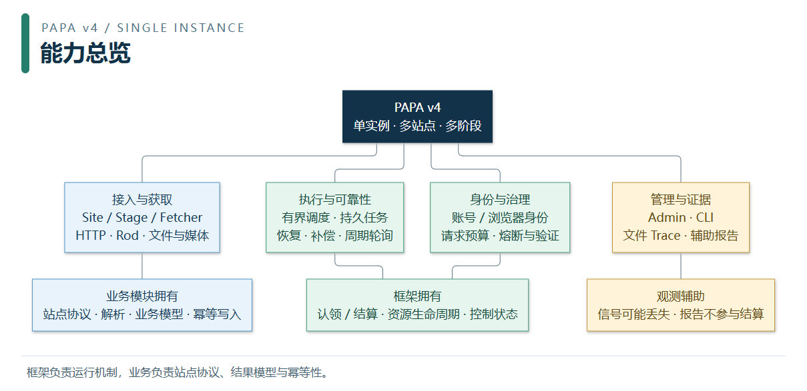
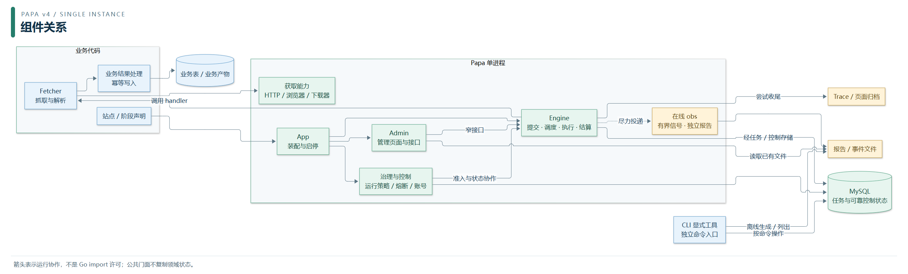
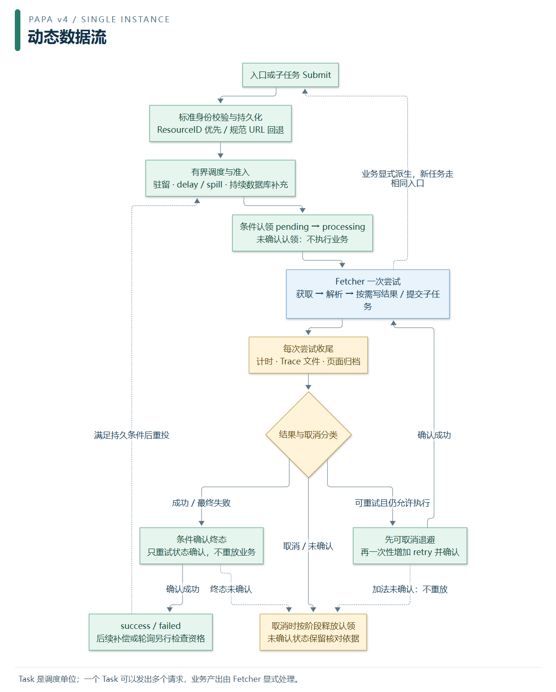
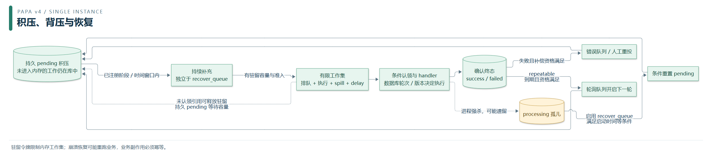
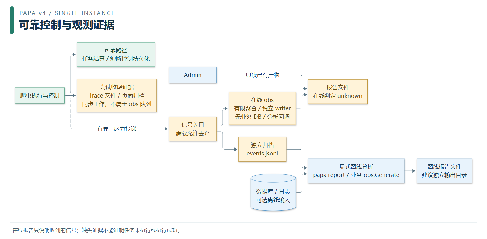
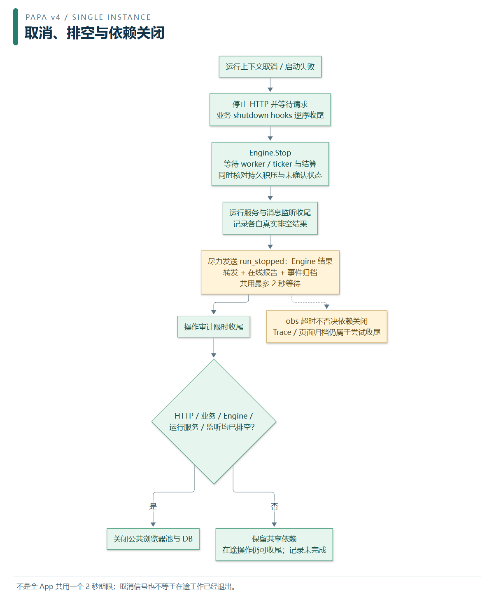

# Papa v4 图册：从能力到运行

> 面向：初次接触 Papa、接入站点或维护框架的开发者。适用当前独立 v4，按单实例设计。返回 [文档导航](../README.md) · [架构与开发](README.md)。

Papa 是可嵌入业务应用的 Go 爬虫框架。它管理任务、执行资源、故障恢复与运维入口；业务实现站点协议、抓取解析和结果保存。下面六张图提供阅读顺序；更细的取消、原子性和锁边界见 [详细架构图解](ARCHITECTURE_DIAGRAMS.md) 与 [目录说明书](../package_structure/README.md)。

蓝色表示业务或显式操作，绿色表示框架执行/可靠控制，黄色表示观测或需谨慎解释的证据。颜色是辅助提示，以节点文字和箭头标签为准。组件图是运行关系图，不授予跨包 import 权限，也不表示所有能力必须在一次任务中启用。

## 1. 能力总览

[矢量图](../assets/diagrams/01-capabilities.svg) · [Mermaid 源码](../assets/diagrams/01-capabilities.mmd)

| 能力 | 谁负责 | 接入入口 |
| --- | --- | --- |
| 站点与抓取 | 业务声明 Site/Stage 并实现 Fetcher，框架提供 HTTP/Rod/下载能力 | [Fetcher 手册](../guides/FETCHER_WRITING_GUIDE.md) |
| 持久任务与恢复 | Engine 协调，任务存储执行条件认领、终态与重投 | [运行调度](../runtime/README.md) |
| 账号与治理 | 各能力组件拥有身份、版本、许可和资源；App 负责装配 | [账号](../accounts/README.md)、[资源预算](../configuration/RESOURCE_BUDGETS.md) |
| 管理与分析 | Admin 调用窄服务接口，CLI 提供显式命令，obs 做辅助报告 | [运维观测](../operations/README.md) |

多站点、多阶段在一个进程中并发，不包含 Master/Worker 分布式部署或多实例任务租约。一个 Task 可发多个请求，甚至不发网络请求；框架不把业务结果存进任务表。

## 2. 组件如何协作

[矢量图](../assets/diagrams/02-components.svg) · [Mermaid 源码](../assets/diagrams/02-components.mmd)

App 装配运行组件；Engine 通过内部调度、worker 和持久化组件执行 Fetcher。Admin 属于运行管理入口，CLI 是显式命令入口，图中分开表示。治理与控制是多个职责组件的概括，熔断协调器属于 Engine，运行策略和账号服务各自拥有状态，不是一个共享“全能服务”。

业务表和框架表按所有权分开，允许位于同一个数据库。HTTP、浏览器和下载器按需调用，并分别接入出口、账号或预算能力；自建原始客户端不会自动获得全部治理。

## 3. 动态数据流：一次任务怎样走完

[矢量图](../assets/diagrams/03-task-loop.svg) · [Mermaid 源码](../assets/diagrams/03-task-loop.mmd)

业务提交任务，框架按站点、阶段与标准身份持久化、去重，调度准入后条件认领，再调用 handler。Fetcher 自行检查获取、解析、保存结果和派发后续任务的返回值；没有自动 `yield Item` 或统一 Item Pipeline。子任务可以早于父任务终态执行，父子屏障须由任务流或业务契约保证。

每次尝试都先收尾再判定下一步。同次认领内的重试先做可取消退避，再一次性增加 retry，确认成功才进入下一次尝试；错误补偿/轮询属于后续轮次。retry 加法确认不明时不能重放加法或继续 handler；终态确认只重试状态写入，不重跑已经完成的业务。成功后遇取消仍有有限的计时与终态确认窗口；熔断样本真实失败和纯取消也分别处理，细则见 [异常口径](ARCHITECTURE_DIAGRAMS.md#图中异常分支的准确口径)。

## 4. 积压、背压和崩溃恢复

[矢量图](../assets/diagrams/04-recovery-budget.svg) · [Mermaid 源码](../assets/diagrams/04-recovery-budget.mmd)

数据库保存持久 pending 积压，内存只保留有限工作集。暂停或无驻留容量时，未认领任务等待后续补充；不会通过把已接受任务标失败来腾内存，也不会把全部数据库积压一次读入。

持续补充 pending 与 `recover_queue` 开关独立。上个进程遗留 processing 的恢复则需要启用启动恢复并满足筛选条件。未确认结算可能已经提交，须核对持久状态，不能统统重跑；业务提交与框架终态不是自动跨表事务，因此业务副作用始终需要幂等。

## 5. 可靠控制、Trace 与 obs 是三条不同路径

[矢量图](../assets/diagrams/05-observation.svg) · [Mermaid 源码](../assets/diagrams/05-observation.mmd)

- 任务结算和熔断恢复使用可靠状态，不以报告是否生成作为成功条件。
- Trace 是文件证据，配置仅 `off/errors/all`，默认 errors、默认七天保留；Trace 和页面归档在尝试收尾中写入，慢盘仍可能延长 worker 收尾。
- 在线 obs 只接收有限信号、分析和写报告，不查业务 DB 或运行分析回调；满载可以丢信号，在线判定固定 unknown。Admin 只读已有报告。
- CLI 离线报告可读事件、日志和数据库；CLI 所有生成模式都要求相应事件。业务可自行组织来源调用 `obs.Generate`，须明确证据缺失。在线/离线写报告没有跨文件事务或共享目录锁，离线建议用独立输出目录。

这些隔离保护执行契约，不代表同进程共享 CPU、内存、磁盘不存在物理资源竞争。更多口径见 [观测手册](../operations/OBSERVABILITY.md)。

## 6. 取消与关停排空

[矢量图](../assets/diagrams/06-lifecycle.svg) · [Mermaid 源码](../assets/diagrams/06-lifecycle.mmd)

图示对应 App 的主要收尾顺序；启动失败也沿同一清理编排，未发出运行开始时不伪造 `run_stopped`。HTTP、业务 hooks、Engine、运行服务和消息监听分别报告真实排空结果；未排空时保留共享 DB/公共浏览器池，不把发出取消或超时返回当成“已经退出”。

Engine 的排空判断还包含 ticker、spill/delay、未确认状态和持久 pending 积压检查；worker 已退出并不一定返回 drained。`run_stopped` 中的 outcome/counts 只来自 Engine.Stop，不汇总 HTTP、业务 hooks 等全部 App 组件，不能据此单独证明整个 App 已排空。

观测转发、在线报告和事件归档共用最多 2 秒等待，超时不否决业务依赖关闭；这不是全 App 的总关停期限，也不包含 Trace/页面归档。审计另有限时收尾；调用方拥有的账号专用资源仍按自身生命周期处理。具体锁、资源和时间预算见 [Internal 说明书](../package_structure/INTERNAL_STRUCTURE.md)。

## 继续深入核心引擎

前六张图解释全框架关联；[Engine 专篇](ENGINE_GUIDE.md) 进一步展开内部组件、调度背压和执行结算三张专图，并说明 LRU、阶段轮转、最小堆、原子认领、有界退避及 repeat 查询等算法。

## 图源与更新

全部图片附带可编辑 Mermaid 源码，PNG 便于普通 Markdown 阅读器显示，SVG 可放大或用于演示。生成步骤、校验清单与适用边界见 [图册维护说明](DIAGRAM_ASSETS.md)。修改执行/控制行为时同步图源与文字，不把图当成另一个状态契约。
