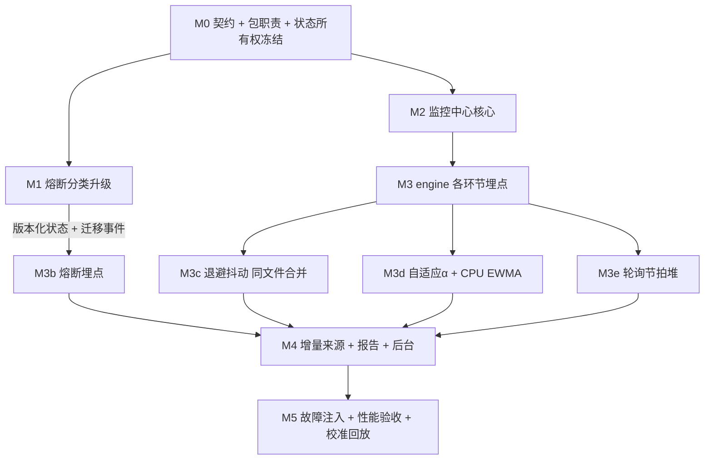

# Papa 大版本计划：统一监控中心 + 分类熔断 + 自适应反馈

<!-- version-scope -->
> **适用版本/阶段：v4 演进期的大版本路线图；统一监控中心及在线反馈耦合设想已被辅助报告定位替代。**
> 勾选清单不是当前能力或继续施工授权；在线 obs 只收信号、分析、记录报告，不持业务 DB 或业务分析回调，见 [观测手册](../../operations/OBSERVABILITY.md)。 本文为设计/计划记录，不能仅凭计划步骤或复选框认定已实现或已验收。 当前使用方式以 [v4 手册导航](../../README.md) 为准。
<!-- /version-scope -->

> **For agentic workers:** 本文件是**大版本路线图**，把三个子系统合并排序；每个子系统在动工时各自拆成 bite-sized 实现计划（TDD、精确文件路径）。执行时用 `superpowers:executing-plans` 逐阶段推进。步骤用 `- [ ]` 跟踪。
>
> 本仓 AGENTS.md 覆盖「frequent commits」：**跳过一切 git 写操作，review 与提交由用户完成。**

**Goal:** 把 Papa 从「有单线熔断、有离线报告、各自为政」升级为「进程内有界监控中心 + 分类熔断状态机 + 自适应反馈」的闭环，且监控永不成为业务执行的前提。

**Architecture:** 先冻结「观测契约 + 包职责/状态所有权」这一共享基座；在基座上依次交付熔断分类升级、obs/monitor 监控中心、四项反馈层算法；三者通过「版本化状态 + 有界事件」咬合，旁路观测、主流程永不等待。

**Tech Stack:** Go、`container/heap`、原子计数、不可变快照、现有 clock/rand 注入测试、race detector、benchmark、合成 fixture、独立只读 MySQL 测试库。

---

## 1. 范围与三份设计映射

| 源设计 | 子系统 | 在本计划的位置 |
|---|---|---|
| `docs/history/designs/2026-11-13-obs-monitor-center-design.md` | 监控中心 | M0（契约）+ M2（核心）+ M3（埋点）+ M4（增量/报告）+ M5（验收） |
| `docs/history/reviews/2026-11-12-breaker-analysis-design.md` | 分类熔断 | M1（三线+状态机）+ M3b（熔断埋点）+ M5（校准） |
| `docs/history/designs/2026-11-12-algorithm-optimization-design.md` | 反馈算法（退避抖动/自适应α/轮询堆/CPU EWMA，**不含代理**） | M3c–M3e + M5（验收） |

**非目标**（三文档共同红线，合并后仍成立）：不引入分布式/多实例；熔断不引入评分或失败率；obs 不写业务控制（不重投/暂停/恢复/换号/熔断控制）；不承诺零开销；真实站点业务接线不进 Papa。

---

## 2. 综合分析：依赖与协作边界

### 2.1 依赖链

### 2.2 三个耦合点（必须显式设计，不能各做各的）

1. **熔断 → 监控的事件契约**：breaker 状态迁移完成后发事件，信封带 `incident_id`、`transition_version`；监控只消费版本化快照，**不反推业务状态、不补造中间迁移**。此契约在 M0 冻结，M1 实现，M3b 接入。
2. **熔断报告 = 监控报告的一个维度**：breaker 文档要求"复用 obs/incident 的初始/过程/最终报告"，monitor 文档要求"报告是监控中心发布的快照"。二者合并为：**监控的 report analyzer 输出里包含熔断报告维度**，不另建报告系统。
3. **重试路径三合一**：`engine/stage.go` 的重试退避（算法①）与监控"重试/执行完成"埋点（monitor P2）落在同一段代码，必须**一次改到位**，避免两次进入同一文件产生冲突。

### 2.3 写入范围重叠表（协调用，advisory 而非锁）

| 文件/包 | 涉及的子系统 | 合并策略 |
|---|---|---|
| `engine/stage.go` | 熔断 M1、监控埋点 M3、退避抖动 M3c | M3c 与 M3 的 stage 埋点合并为一个任务 |
| `pkg/governance/controller.go` | 自适应 α M3d、AutoThrottle 埋点 M3 | 合并为一个任务 |
| `engine/dynticker.go` + 轮询队列 | 轮询堆 M3e、轮询队列埋点 M3 | 合并为一个任务 |
| `pkg/governance/resources.go` | CPU EWMA M3d、资源采样埋点 M3 | 合并为一个任务 |
| `internal/breaker` | 熔断 M1（三线） | 独立，不与他方冲突 |

---

## 3. 包职责与状态所有权（硬规则落地）

依据 AGENTS.md「包职责清晰」与 monitor 文档 §3，本版本开始前先冻结下表，任何实现不得违反：

| 包/组件 | 单一职责 | 状态所有权 | 对外接口 | 允许依赖 |
|---|---|---|---|---|
| `internal/app` | 组件装配 + 生命周期编排 | 无业务状态 | Start/Stop/RegisterSites | 各组件构造函数 |
| `engine` | 执行编排（认领/尝试/终态/重试/队列） | 任务状态、暂停信号、**熔断状态机**、各队列 | Fetcher/Notifier/公开 API | core/models/`internal/*` 经接口 |
| `internal/breaker` | 熔断计数与阈值判定（扩为三线） | 滑动窗口计数（**不持暂停状态**） | RecordFailure/Reset/Sum | 无（扫源码守卫"不 import core"保持） |
| `obs/monitor` | 旁路观测中心 | 聚合快照、健康槽 | Observer/Snapshot/API | **不 import engine 可变对象** |
| `obs/incident` `obs/analyze` | 熔断证据分析 + 报告 | 无（纯函数） | Analyze/Text/Report | redact |
| `pkg/governance` | 请求预算/限流/AutoThrottle/资源 | siteState/classes | Observe/Acquire/Snapshot | 无 |
| `pkg/events` | 事件发射/归档 | emitter 状态 | Emit | 无 |
| `internal/msgqueue` | 消息队列 | 队列状态 | Send/Errors/Activities | 无 |

三条红线：**熔断状态机归属 engine**（obs 只解释事实）；**Collector 独占聚合可变状态**（不查库、不写文件、不调扩展）；**后台 handler/页面资源/接口测试按功能归属**，不因嵌入方便塞进 app 装配层。

---

## 4. 阶段交付（M0–M5）

### M0 契约 + 包职责 + 状态所有权冻结

**Files:**
- Create: `obs/monitor/contract.go`（`Observer`/`CountersHandle`/`EventValue` 协议，先协议后实现）、`obs/monitor/budget.go`（预算常量与校验）、`docs` 所有权表落档
- Modify: `pkg/events` 适配层限长/复制/限属性

**完成标志：**
- 非阻塞 `TryEmit` 契约、no-op observer（关闭时业务照常）、基数/字节上限校验、所有权表文档化。
- breaker→monitor 的事件信封契约（`incident_id`/`transition_version`）定稿。
- 依赖 M1/M2/M3 全在此契约上，不留「等实现时再定」的缝。

### M1 熔断分类升级（三线 + 状态机 + 版本化状态）

**Files:**
- Modify: `internal/breaker/breaker.go`（单线 → 三窗口/三谓词，保留终态失败计数语义）、`engine/breaker_*.go`、`engine/pause.go`（恢复状态机 + 所有权校验 + 预算校验）、`obs/incident`（L1 结构化校验码优先级链）、`obs/analyze`
- 参考：`docs/history/reviews/2026-11-12-breaker-analysis-design.md`（三条线谓词、指纹优先级链、状态机、待校准表）

**完成标志：** 三条保护线谓词、恢复状态机（正常→暂停→冷却→试探→小流量→正常）、人工暂停不被自动解除、版本化状态迁移事件可被 M3b 消费。**校准默认值**（短/常规窗口、阈值、观察预算）通过合成故障 + 历史回放确定，见 M5。

### M2 监控中心核心（collector/snapshot/supervisor/writer/service）

**Files:**
- Create: `obs/monitor/{collector,snapshot,supervisor,writer,service}.go`
- Modify: `internal/app` 独立 obs 接线文件（不堆入 `app.go`）、`config`（`obs.monitor` 段，见 monitor 文档 §9 草案）

**完成标志：** 无 I/O collector、单写者增量聚合、不可变快照（≤2 代、原子指针）、各角色最多一个后台执行单元、限时停止（2s 总预算）、旧定时报告循环停用（新旧不并存）。

### M3 埋点接入 + 反馈层算法（写入范围最集中，分子任务）

**M3a engine 埋点**：`engine/stage.go`、`task.go`、队列文件、`spill.go`、`persistence.go` —— 每个计数绑定唯一更新点，attempt/task 分母分开（重试不虚增失败任务）。

**M3b 熔断埋点**：消费 M1 的版本化状态 + 迁移事件，落入「熔断」埋点行。

**M3c 退避抖动**（与 M3a 的 stage 重试埋点**合并**）：`internal/backoff` 统一函数 + `engine/stage.go:311`、`filedown/downloader.go:587`、`m3u8/downloader.go:200`、`m3u8/downloader.go:876` 四处替换；配置 `retry.max_backoff`/`retry.jitter`（默认 full）。

**M3d 自适应 α + CPU EWMA**（与 governance 埋点**合并**）：`pkg/governance/controller.go`（`α_eff = clamp(α_base·(1+k·r_429), α_min, α_max)`）、`resources.go`（`cpu_avg ← (1−β)·cpu_avg + β·cpu_sample`，`β=1−e^(−Δt/τ)`）。

**M3e 轮询节拍堆**（与轮询队列埋点**合并**）：`engine/dynticker.go` + 轮询队列，复用 `delayqueue.go` 的 `container/heap` 模式，DB 仍是权威、堆是缓存、到点重读防重跑、重启全量重建。

**完成标志：** 每子任务独立可验证；M3c 固定种子下 sleep 落区间、惊群分散；M3d 虚拟时间回放收敛优于固定 α；M3e 堆顶恒等于 DB 最小 `next_run_at`。

### M4 增量来源 + 报告 + 后台

**Files:**
- Create: `obs/monitor/{tailer,dbprobe,checkpoint,analyzer,reporter}.go`
- Modify: `admin/server`、后台页面资源（按功能归属，不堆 app 层）

**完成标志：** log tailer（轮转/半行/超长/限速）、只读 DB probe（独立池 max_open=1、无全表聚合、可取消）、checkpoint（聚合+游标同原子发布单元）、报告原子代际切换（manifest + current 指针）、`runtime_health`/`observation_quality` 双维度、旧日报目录只读兼容。

### M5 故障注入 + 性能验收 + 校准回放

**完成标志（门槛，非目标值）：**
- 业务吞吐下降 ≤2%、任务 p99 延迟增加 ≤5%（同硬件对照 obs off/on，5 次取中位数）；
- 新增 obs steady heap ≤64 MiB、CPU ≤单核 5%、热路径普通埋点 0 alloc/op 且 p99 ≤5 μs；
- 故障注入（阻塞 sink、磁盘满、analyzer panic、DB 断开、日志洪水）业务照常、obs 2s 总预算内返回、每角色最多遗留一个 worker；
- 熔断阈值/窗口通过合成故障与历史事件回放校准定稿；校准前不得宣称"不会影响正常运行"。

---

## 5. 跨阶段风险与保护

1. **已有未提交熔断修改必须保留**：monitor 文档 §2.1 明确"基于包含已有未提交熔断修改的工作区"。M1 动 `internal/breaker`/`engine/breaker_*.go`/`obs/incident` 前先 `git status`/`git diff` 核对现状，不得用旧版本覆盖。
2. **待校准项汇总**（跨三文档）：短/常规窗口、三线阈值、最小样本量、观察预算、关联维度容量、Probe 契约、路由分组接口、obs 各预算默认值 —— 统一在 M5 校准/性能验收，不得在 M1–M4 中途顺手定死。
3. **新旧不并存**：新 monitor 上线即停用旧 emitter 快照/定时报告循环，避免重复埋点与重复输出；回退通过配置 `monitor.enabled=false`（旧 `events.enabled` 映射兼容，见 monitor 文档 §9）。
4. **熔断报告不回流控制**：`obs/analyze/breaker_reports.go` 的事实来自持久历史，事件流不可靠时展示当前保护状态，不补造中间迁移。

---

## 6. 里程碑

| 里程碑 | 判定 | 依赖 |
|---|---|---|
| 基座冻结 | M0 契约 + 所有权表通过，三主线可并行启动 | — |
| 熔断闭环 | M1 + M3b：三线触发 + 版本化状态 + 报告维度 | M0 |
| 中心可读 | M2 + M3a：埋点计数 + 快照 + API 可读 | M0 |
| 反馈可调 | M3c–M3e：退避/限流/节拍/资源四项优化落地 | M0 |
| 全量可观测 | M4：增量来源 + 原子报告 + 后台 | M1–M3 |
| 发布门槛 | M5：性能/隔离/校准全部达标 | M4 |

---

## 7. 文档同步清单

命中即同步：`docs/operations/OBSERVABILITY.md`、`docs/configuration/CORE_CONFIG.md`、`docs/operations/CLI.md`、`docs/operations/MONITOR.md`、`docs/architecture/DEVELOPMENT.md`、`docs/runtime/BREAKER.md` 观测说明、`cmd/papa/templates` 模板。新增配置项（`retry.jitter/max_backoff`、`autothrottle.*`、`resources.cpu_*`、`obs.monitor.*`）按 papa-docs-sync 分工矩阵落位。

---

## 8. 后续执行方式

本路线图不展开成 bite-sized 任务（三子系统各需一份独立实现计划）。执行时按里程碑顺序，**每个子系统用 writing-plans 单独产出**含精确文件路径 + 完整代码 + 测试命令的实现计划，再走 executing-plans 逐任务落地。

**建议首个里程碑先做 M0 + M3c（退避抖动）**：M0 是全局地基；M3c 改动最小、风险最低、且有明确的惊群收益，可作为"验证 TDD + 计划粒度"的探路任务。
