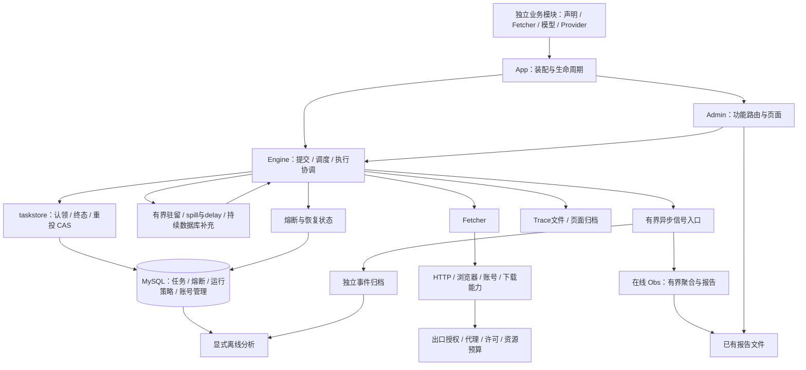

# Papa v4 最终框架画像与收尾结论

<!-- version-scope -->
> **适用版本/阶段：独立 Papa v4 的阶段汇总（更新日期及各批验证范围见正文）。**
> 当前契约与历史验证分开阅读；链接到旧诊断不意味着 SQL Trace、旧库转换或旧兼容 API 重新受支持。本次文档核对不重新证明历史测试结果。 当前使用方式以 [v4 手册导航](../../../README.md) 为准。
<!-- /version-scope -->

日期：2026-11-13；更新：2026-11-14。面向当前工作区；验证明细与历史修正见 [v4 清理报告](../2026-11-13-v4-independent-cleanup.md)，包职责见 [目录说明书](../../../package_structure/README.md)。本文替代初诊画像中关于旧接口、SQL Trace 和旧库升级的当前能力描述；历史诊断保留为证据。

## 定位与总判断

2026-11-14 使用手册复核已同步当前 Trace、显式迁移、任务恢复、账号入口和 obs 在线/离线边界，历史报告单独标注适用阶段。详见 [当前手册核对记录](../2026-11-14-v4-current-manual-audit.md)；本次只调整文档，没有重新声明全仓、真实数据库或生产负载验收。

Papa v4 是代码驱动、可嵌入业务应用的 Go 单实例模块化爬虫框架。它覆盖任务持久化与调度、HTTP/浏览器抓取、账号与身份、下载、运维后台及观测报告。真实站点、业务模型、固定采集目标、Provider 和业务验收由独立业务模块承担。

当前已闭环的是：确认过的旧兼容/废弃入口清理、相关当前调用链回归、独立 MySQL 结构与读写验收、百万行启动身份校验测量、浏览器共享目录误删修复，以及当前手册同步。进一步补齐了单实例十分钟合成持续负载、Engine 关停超时及真实子进程强杀恢复验证，以及真实 App 组合根、两站点/两阶段混合负载和依赖关闭门控验证。没有把“闭环”扩大成所有输入、所有硬件、所有插件或生产故障均无风险的证明。多实例协同、分布式租约及横向扩容不属于框架目标或待补能力。

## 运行关联

2026-11-14 补充 [六图介绍](../../../architecture/PAPA_OVERVIEW.md)，包含能力、组件、任务循环、背压恢复、观测及关停。目录调整与 CLI 分发保护验证见 [复审记录](../2026-11-14-docs-layout-rereview.md)；这批验证不扩大此前数据库与负载结论。

同日二次复审校正了图中退避/retry 的先后、Engine 排空判据及 run_stopped 的范围；CLI 刷新改用临时文件替换，避免经硬链接改写业务内容，补齐链接、业务全快照与失败清理断言。详见同份复审记录的“二次复审”。

随后在最终代码上完成全仓 test 与 race，各 77 个测试包、2,946 个测试/子测试通过，124 项 skip；发现并修复受管页面创建应答与取消竞争的 target 所有权漏洞，以及两处测试阶段/时间预算脆弱点。普通和 race 的跳过集合相同，本批没有重跑真实 MySQL/可选环境验收；首轮失败、最终证据与范围见同份报告“最终全仓测试与 race 补验”，逐项见 [跳过清单](../2026-11-14-docs-full-validation-skips.md)。

可分发的完整结构与行为图见 [架构图解](../../../architecture/ARCHITECTURE_DIAGRAMS.md)：分别提供静态组件图、动态数据流图，并明确 Spider/Downloader/Pipeline 等名称与 Papa 实现的对应。下图保留画像的简要运行关系。

图中箭头表示运行调用或数据流，不表示允许各包互相导入。具体依赖仍受窄接口、internal 边界与架构守卫约束。

图解源码复核补正：熔断协调器归 Engine，运行策略服务独立持有策略事务；Admin 读报告文件，不调用在线 Runner。pending 持续补充独立于启动恢复开关，遗留 processing 的恢复另有启动筛选；重试计数的模糊写入不能重放加法，终态版本冲突也不能画成无限重试。取消、迟到熔断样本、计时与 panic 的具体分支见 [架构图解的异常口径](../../../architecture/ARCHITECTURE_DIAGRAMS.md)。obs 三路共用 2 秒退出 deadline，Trace/页面归档不在这条异步链上。此次只修正文档表达，未改变运行语义。

## 各层能力与所有权

| 层 | 当前能力 | 所有权与边界 |
| --- | --- | --- |
| 根包 / config / core / models | 当前公开门面、严格配置、声明值、版本化任务身份及模型 | 根包不另存运行状态；core 为标准库值契约；模型 hook 不代替协调器状态事务 |
| Engine | 多站点/阶段、优先调度、延迟/溢出、恢复/错误/轮询队列、任务流、补偿与熔断 | 同包组件分别拥有提交、调度、执行和证据；认领/终态/重投按版本控制，业务副作用仍须幂等 |
| Internal | App 装配、声明冻结、运行策略、报告执行、任务/熔断/Trace 存储适配 | App 负责协调启停；领域状态归服务，SQL 条件归存储组件，不向 HTTP 或 Engine 反向持有整对象 |
| Pkg | HTTP/HTML、发现/提取、账号认证与健康、浏览器身份、出口治理、filedown/m3u8 | 组件拥有自身资源/许可/状态；宿主回调须响应取消。临时目录是共享父目录，实例只清理自己的 profile |
| Admin | 任务与队列操作、账号/身份/策略、日志/报告/追踪、鉴权和审计 | server 负责组合；handler 和 JS/CSS 归功能包；前端会话/请求代次与销毁由控制器负责 |
| Obs | 在线有限信号聚合与报告；显式离线流式历史读取、查库对账与分析扩展 | 在线不持业务 DB/回调，固定 collector/writer、有限队列、满载丢弃；可靠熔断契约归 pkg/incident，缺失观测不能推断成功或未执行 |
| Cmd | new/check/migrate/upgrade/debug/act/report/token 与合成脚手架 | 只支持当前 v4 工程及目录；迁移显式执行，不能自动升级旧业务库 |

## 独立 v4 的契约

- 不提供 v3 或更早版本的 API 空壳、配置映射、旧任务身份回填、旧熔断快照转换及旧 CLI 布局回退。当前根包门面、第三方协议支持和有效零值默认不是历史兼容层。
- 任务采用 ResourceID，留空时采用规范 URL；身份由站点、阶段、类型和值生成 SHA-256，数据库约束为 `(site, stage, identity_hash)`。启动/迁移只读检查旧列、旧索引及缺失身份数据，失败拒绝，不转换或删旧数据。
- Trace 仅文件存储，`off/errors/all`，默认 errors、默认七天保留；errors 保留失败、panic、显式 Fail/Warn 等异常证据。无手动追踪线路、无 SQL Trace 迁移；`ListTraceExecution` 查询最新保留执行的有界尾部，不代表任务当前终态。
- filedown 读取当前 v2；m3u8 当前生产写入仍有 v1/v2，二者均保留。无版本格式拒绝；不能仅凭数字小就删除当前协议。
- 旧调用方必须调整 API/配置并使用独立 v4 数据库；本轮没有迁移真实业务库。

## 关停排空的实际契约

1. App 取消运行，停止 HTTP 准入并核对 handler/白名单重载；业务收尾、Engine、账号/身份/诊断及消息监听各自返回真实排空结果。
2. Engine 关闭新池准入并取消，worker 与 ticker 共用其 Stop 截止时间；队列/驻留/持久 pending 和未确认执行、熔断持久化结果都参与未完成判断。取消信号不是排空成功。
3. 运行组件先关闭所有准入再等待，某个超时不能让后续组件继续接收新工作。App 仅在所有相关结果允许时关闭共享 DB/浏览器，否则保留依赖。
4. Pool.Close 关闭准入和空闲实例；借出及创建中的实例经各自归还/晚到路径清理。配置根不删除，不破坏其他池、诊断和在用 profile；Pool.Close 不是宿主的完整排空器。
5. 观测转发、报告和归档共用最多 2 秒等待预算，超时不阻止业务资源关闭；在线观测单元不持业务 DB。整个 App 仍没有统一硬退出总时限：审计 Close、代理刷新等待或业务 Provider 不合作仍可能延长等待。`run_stopped` 的 Engine drained 也不等于整个 App 全部排空，不能通过提前销毁依赖掩盖。

## 已有实测证据

| 验证 | 结果及范围 |
| --- | --- |
| MySQL 8.1.0 独立随机库 | 新库完整建表、重复迁移、12 类旧结构/非法身份拒绝；拒绝前后结构和数据不变；当前任务认领、结算、版本化重投与身份去重/重启回归通过，所有测试库确认清除 |
| 百万行启动身份校验 | 当前连续三次约 1.095 / 1.194 / 1.213 秒；不是严格冷缓存、不是整个 App 启动时间。首行非法约 31ms，末行约 1.39s；合法库仍 O(N) 扫描 |
| 浏览器共享目录 | 原根目录删除的两类故障已复现；修后真实 Chromium 证明借出实例存活、共享池继续工作及 profile 独立清理；浏览器全包 race 149 项通过、9 项跳过 |
| 单实例真实进程恢复 | 独立 MySQL 库、启用 RecoverQueue；认领后、幂等结果提交后、Stop 超时后三个切点，真实强杀旧子进程并启动新进程。三轮 race 验证全部通过：每组 64 条任务恢复成功，强杀时 2 条 processing、16 条未来延迟任务；实际 66 次 Handler 入口对应 64 份唯一幂等结果 |
| Engine 关停超时 | 不响应取消的合成 Handler 下，Stop(50ms) 实测约 50–51ms 返回 drained=false；处理中的任务仍留库，重启后恢复。不是 App 全生命周期的硬退出时限 |
| 验收证据与清理复审 | 切点绑定具体任务与结果提交状态；Stop 有调用、未完成统计和耗时断言；逐任务检查重放与原始输入集合。六类篡改证据反例及故意断言失败后的清理验证通过；自有库 DROP 后按精确库名查询确认不存在，不能外推到父进程硬退出或数据库不可用 |
| 十分钟单实例持续负载 | 复审补强后联合 race 命令整体通过：关闭启动恢复队列，单独验证持续回灌；10m2.617s 内 12,672 条任务全部成功、结果一致并排空，驻留采样峰值 16（预算 16）、持久积压峰值 64，Go 堆采样峰值约 4.12 MiB，无中途无进展或 race 告警。负载会阶段性排空，不是持续饱和或生产长稳/RSS 上限证明；此前两轮及夹具校准记录见清理报告 |
| App 生命周期与混合负载 | 从 NewApp/RegisterSites/Run 到 Shutdown 或取消；复审一分钟 race 正常场景 3,888 条任务和派生结果一致。暂停 alpha 时 beta 完成、采样驻留不超过配置 8；取消、超时、强杀重启三轮通过。HTTP 在途请求/收尾 hook 不提前失去 DB，审计 16 条落库、生命周期事件与四份报告正确；部分退出保留 DB/池，完全排空后关闭，监听器与自有循环退出。补强逐次延迟时间、事件顺序、报告目录、TCP 关闭和临时目录清理；超时后两个存活 handler 再次写库通过。范围为受控合成业务，非所有可选插件验收 |
| 活跃排空与失败清理 | 四组活跃 handler 取消后成功收尾及断言失败清理各三轮 race 通过。修复成功业务结束时间/终态被取消阻断的问题：Engine 内部各给予最多 2 秒的版本条件确认窗口；不重跑业务，未确认仍保留依赖 |
| 一分钟饱和与公平性 | 四组 pending 采样最低 58，全局驻留采样峰值 4；3,023 次独立采样最长无进展间隔约 480ms。停止补充后 2,366 条任务/结果/尝试逐项一致。范围为单 worker、20–80ms 合成处理、4/3/2 驻留预算下的有界进展，不承诺严格均分或生产 SLA |
| 整体收尾回归 | 最终普通全仓测试、生命周期/取消/存储定向 race、vet/build 结果见清理报告的整体收尾节；不累计不同批次测试数，不把跳过算作通过 |
| obs 故障隔离 | 在线无 DB/业务回调/历史扫描，归档及报告 writer 阻塞/panic 均有独立回归；独占 MySQL 下关闭观测、归档阻塞、归档 panic、报告不可写四场景与活跃排空/取消/超时/强杀恢复通过。77 个有测试包及 Engine 全量 race 通过；详见 [实施证据](../2026-11-14-obs-sidecar-implementation.md)，不据此承诺物理零开销 |

## 剩余风险及未验证项

| 边界 | 当前结论 |
| --- | --- |
| 资源上界 | 输入预算和有界工作集已实现；Task 的业务载荷、插件、外部 Chromium/ffmpeg、成功产物保留不等于进程 RSS 或磁盘硬配额 |
| 大库启动 | 校验会扫描合法任务表；未测千万级、宽记录、严格冷缓存、慢盘或生产并发，不能直接外推百万行结果 |
| 崩溃与恢复 | 已完成 Engine 单阶段和完整 App 组合根的真实子进程强杀恢复，App 覆盖两站点/两阶段、HTTP、事件/报告、审计、运行采样及空浏览器池。未做 MySQL 服务崩溃、断电、文件系统故障和生产长稳；无真实账号 Provider、浏览器实例或下载器在途。业务非幂等副作用不承诺 exactly-once |
| 证据与产物 | Trace/归档写入可能失败，事件可丢，报告多文件并非整组事务；观测记录空白不能作为执行结论 |
| App 验收边界 | 已补四组活跃 worker 正常关停、受控持续积压下有界进展及 App 断言失败清理。未独立验证各站点/阶段完整驻留峰值、任意负载公平性或报告统计全量准确；超时后不保证自动二次关库 |
| 关停 | Go 无法强杀回调/文件 I/O；obs 单独有界等待且不持共享业务依赖，其他业务组件未排空仍保留依赖，整个 App 退出时长不保证统一硬上限 |
| 浏览器磁盘 | 根目录及不属于实例 profile 的文件保留；异常退出可能留下文件，不能允许 Pool 无所有权依据地递归删除；本轮 live 在 Windows，本次未补 Linux/macOS |
| 部署与业务 | 未操作业务数据库、未验收真实站点/凭据/Provider、未部署；其他 MySQL 版本、ffmpeg 组合、代理环境和生产负载需按实际部署验收 |

结论是“当前确认事项已完成修复、验证及文档闭环”，不是生产无风险认证。后续开发继续按包职责、状态所有权、版本原子性和真实排空契约推进。

## obs 复审补正

在线 DB/业务回调隔离及可靠控制协议边界经复核保持。补正入口事件时间与并发序号、单调接收日桶、迟到信号质量、长维度不混算，以及故障测试实际触发/清理断言。观测退出预算仍为共享 2 秒；详见 [复审证据](../2026-11-14-obs-sidecar-review.md)。

## obs 解耦后的整体收尾

按七个模块复核职责与实际运行链，在线观测不重新借用业务 DB/回调，Admin 只读取已生成的报告文件。补齐熔断启动恢复的在途排空登记，停止与初始化准入共享短同步边界、锁不跨存储；Stop 不再把仍在恢复读写的引擎判为已排空。事件超预算文本整体省略以避免破坏凭据脱敏结构；后台和 CLI 的配置/unknown 提示同步。验证批次及剩余边界见 [整体收尾报告](../2026-11-14-framework-final-review.md)。

## 最终代码复审

进一步补齐并发恢复初始化：可取消恢复 gate 防止重复加载及越过未完成 flush，成功标志在持久化与循环交接后发布。事件配置身份计入总预算；报告失败样本的二次限长采用整值省略，保持脱敏结构和缺失说明。前两轮全仓暴露的事务守卫与旧同步事件断言也已修正。

最终同一冻结版本的普通全仓与全仓 race 均通过：各 77 个有测试包、2,925 项通过、124 项环境门控跳过、0 失败，vet/build 通过，1,039 文件 SHA256 核验无差异。独占 MySQL 补验覆盖结算恢复、调度补充、活跃排空以及 App 正常退出/取消/超时/强杀重启；不把这些选择的场景视为全部跳过项均已补齐。日志、断言补强、清理证据与剩余边界见 [最终代码验收](../2026-11-14-final-code-rereview.md)。

## 124 项门控测试补验

上一节 124 项原始 skip 已逐项对账：94 项 MySQL、23 项本地 Chrome、2 项 FFmpeg、2 项 POSIX 权限、3 项父测试子进程入口。上一轮有直接记录的是 41 项实库场景及 2 个 App 子进程入口；本轮 121 个独立场景全部通过（119 项 race，2 项在 WSL Linux 原生临时目录执行），三个入口均由父测试驱动并验证恢复和清理。原清单无剩余未验证 ID，默认全仓仍保留 124 项门控/平台/入口 skip。

真实 FFmpeg 补验发现 `-fs` 错放在输入侧，已按 m3u8 下载器职责修正；新增输出超预算时保留旧产物和清理 staging 的真实进程回归。修后完整普通测试 77 包、2,925 项通过，m3u8 整包 race 及全仓 vet/build 通过；本轮未再次执行全仓 race，不沿用修前全仓结果证明新增修改。

本轮合成证据补充：Engine 60 秒负载完成 1,280 条任务，驻留峰值 16；App 四组短时饱和均有进展，驻留峰值 4；百万行启动校验三次约 2.81 / 2.93 / 1.99 秒。框架表只读查询覆盖独立合成库全部 13 张表。测试库名差异为空，浏览器无新增残留进程，Linux 自有临时目录清理完成。

这补齐的是列出的本地场景，仍未验证生产站点/真实 Provider、24/72 小时长稳、断电/存储故障、完整 Linux/macOS 生命周期及 Linux race、其他浏览器/FFmpeg/MySQL 组合。逐项测试名、环境和失败修复记录见 [补验报告](../2026-11-14-skipped-tests-verification.md) 与 [124 项清单](../2026-11-14-skipped-tests-inventory.md)。

## 有界退避与抖动（2026-11-14）

Handler 与下载重试已收口安全时长计算：`internal/backoff` 无状态、无等待与持久化职责，各调用包拥有自己的策略；Handler 指数值封顶 60 秒，下载保持 10 秒，随后 Equal Jitter。没有新增公开配置字段、DB 迁移、锁或关停循环；重试计数确认、版本认领、取消、终态和原资源释放顺序保留。改变的是等待分布，不是尝试次数；不承诺生产峰值或请求总量必然降低。

退避实施阶段尚未测量 CPU EWMA、自适应 α、repeat 有界缓存；后续合成评估见下文。全量轮询堆与 PID 不纳入当前实施。详细证据和未验证范围见 [退避实施报告](../2026-11-14-retry-backoff.md)，不将此批正确性验证扩大为生产性能验收。

本批最终普通测试与全仓 race 各通过 78 个测试包、2,963 个测试及子测试；124 项门控跳过、5 个包无测试。vet/build 通过。源码输入指纹核对与终版文档分发检查通过；本轮未连接真实 MySQL，不以先前补验代替当前验证。

退避后续[全面复审](../2026-11-14-retry-backoff-rereview.md)保留计算算法，修复 retry 加一入口写前已取消仍加次数/误标未确认的窗口；写入开始后取消仍保留未确认、不回退或重放。同时修正等待取消推断、抖动范围假通过、Stop 首次结果漏断言及失败清理证据。新增虚拟时间、独立整数参照与错误变体拒绝测试；计算包独立 Windows 386 通过，不扩大为全框架 32 位或生产负载证明。

退避复审最终代码再次完成全仓普通/race：每轮 78 个测试包、2,980 个测试及子测试通过，124 项门控跳过、5 个包无测试；vet/build 通过。完整文件集合和 1,078 个输入 SHA256 一致，无执行期漂移。跳过分类、写前取消修复反证及验证限制详见本批复审报告，不代替真实 MySQL 或生产性能验收。

## 剩余算法的合成评估（2026-11-14）

已用真实治理控制器回放、并发微基准及本地随机 MySQL 库评估剩余方向。CPU EWMA 延迟持续过载识别；方向性 α 没有增强现有 429 快速退避且延长恢复，当前均不引入生产。repeat 最早时间聚合在 100k 稠密任务/16 个阶段上限下达到约 225–342ms，确认规模相关成本；先研究语义等价 SQL 优化，暂不承担缓存失效和生命周期状态。测试侧无缓存候选不等于已上线能力。详见 [合成评估报告](../2026-11-14-algorithm-evaluation.md)，明确区分指标模型、实库查询与真实爬虫吞吐；本轮不修改生产代码。

## Repeat 单语句查询复审（2026-11-14）

复审发现有序候选不等价：范围内非法日期可转换为 epoch=0，按 DATETIME 取首条会漏掉；调用方排序、LIMIT/OFFSET 也改变聚合结果。已撤销 UNION/EXISTS 快速路径，改为终态/未来条件下推的单条过滤聚合；公开 API、轮次原子更新、取消、锁序、tickerWG/Stop 排空和无缓存约束不变。

原报告 100k 稠密任务降至 1–4ms 的数字属于已撤销实现，不能作为当前能力。当前查询仍存在规模相关扫描成本；异常日期、NULL、上限、事务视图及真实 SQL 取消由独立 MySQL 验证，最终性能、全仓测试/race、跳过项和范围见 [复审报告](../2026-11-14-repeat-query-rereview.md)。CPU EWMA、自适应 α 和 repeat 缓存仍不落地。

### 全达上限成本后续

最早排期仍使用单条过滤聚合，不恢复有序首条假设。本轮将自动/强制/最早排期共同使用的 RepeatLimit 条件按相同阶段、相同正上限合并站点；不改写入、取消或排空契约，不增加缓存、索引或运行时策略。独立实库候选显示常见多站点共享约束可降低残余条件比较成本，读取量仍为扫描级；不同分布和未验证范围见 [成本与验证报告](../2026-11-14-repeat-cap-cost.md)。前节引用的全达上限回退数字对应合并前实现。

后续 [条件合并复审](../2026-11-14-repeat-cap-rereview.md) 保留生产实现，补齐三值逻辑标量对照、同阈值跨阶段、分组查询取消/排空和性能夹具断言；四类错误注入均被测试拒绝。新增断言后的两轮 100k 全达上限相对合并前改善 12.9%/14.1%，仍未减少全范围读取。当前代码最终验证及未验证范围以该复审报告为准。
