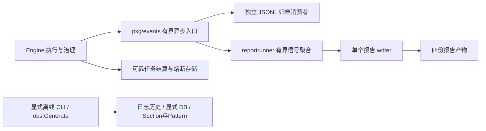

# obs 辅助报告隔离实施与验证

<!-- version-scope -->
> **适用版本/阶段：独立 Papa v4 的 obs 辅助报告设计/实施阶段（2026-11-14 修订定位）。**
> 在线信号旁路与显式离线分析的当前契约见 [观测手册](../../operations/OBSERVABILITY.md)；正文测试与实施步骤保留其当次适用范围。 当前使用方式以 [v4 手册导航](../../README.md) 为准。
<!-- /version-scope -->

日期：2026-11-14。依据 [修订设计](../designs/2026-11-13-obs-monitor-center-design.md)，先修订定位，再按事件边界、在线聚合、App 接线和回归四阶段实施。保留已有工作区修改；未操作业务数据，未执行 Git 写操作。

## 结果与职责

在线 obs 只接收有限值信号，进行增量分析并记录报告；不持有业务 DB，不调用业务分析回调，不扫描历史日志。它不参与任务结算或熔断恢复的成功判定。

- **pkg/events**：异步前复制并限制字符串和 map；每条最多 64 个 map 项、单字符串 2 KiB、字符串总计 16 KiB。未知 Emitter 只包装一次固定队列/消费者；队满允许丢弃，回调/时钟/Write/Close 均不在生产者执行。panic 禁用消费者；永久阻塞不创建替代 goroutine。
- **Engine**：快照只尝试获取内存锁，忙则跳过并标记截断；不再复制全部 worker 活动。保留阶段/队列标量与本轮处理数。Engine 只请求关闭自己包装的出口，App 的入口留到 run_stopped 后收尾。
- **internal/reportrunner**：没有 DB、Engine 或业务回调字段；一个 collector、一个 writer、最多 1024 条接收队列、256 个分组维度、16 条失败样本和一个待写快照。请求合并，不随输入增加 goroutine。统计以当前进程接收自然日为准，输出来源 signals、coverage partial、整体 verdict unknown；不会把信号数冒充任务表权威总数。
- **internal/app**：仅装配并分发信号，转发、报告和归档共用最长 2 秒收尾 deadline。观测超时不进入业务 DB/浏览器关闭门控；晚到单元只持有文件与纯值数据，不借用业务资源。
- **obs**：保留显式离线 Generate、历史流式读取与分析能力；Section/Pattern 的 Key/Title/Build/Match 各自恢复 panic，在边界检查取消。没有每回调 goroutine，也不宣称能终止不响应 context 的离线代码。
- **pkg/incident**：从 obs/incident 提出可靠失败/熔断证据值契约与校验，不留旧路径壳。Engine、breakerstore 与 Admin 直接依赖它，JSON 字段及持久化语义不变。观察事件仍可丢弃，可靠结算、历史确认和恢复快照仍走原存储协议。

移除 App.UseReportSection / UseReportPattern；需要业务报告的调用方改用显式离线 obs.Generate。保留现有开关、目录、周期和保留配置；report.mode、timeout、thresholds 用于离线分析，不再驱动 App 在线查库。UseReportInputLimits 的在线作用是限制接收队列与维度，不把离线扫描/spool 参数伪装成在线行为。

## 复核时进一步修正

1. 快照优化最初遗漏 QueueSnapshot.RunProcessed；恢复基于队列本轮起点的计算，增加运行中/结束后的断言以及业务锁占用时立即返回并标记截断的测试。
2. 独立归档丢失与在线入口丢失分开记录，不能因为归档故障就声称同一信号没有进入聚合。writer 故障可通过原子健康快照读取，不依赖故障中的报告文件自证健康。
3. 在线保留清理只删除过期日期目录内四份已知产物；分批遍历，防止无关目录项遮挡后续过期产物。不递归清理未知文件，也不复用离线历史报告保留策略。
4. 更新依赖守卫：在线 Runner 禁止引入 SQL/GORM 和历史扫描包；Engine/可靠熔断存储禁止依赖 obs 报告命名空间。

## 验证证据

日志位于本地 `.review-tmp/`；它是验证证据目录，不属于产品运行数据或公开文档 API。

| 验证 | 实际证据与范围 |
| --- | --- |
| 普通全仓 | `obs-all.jsonl`：`GOWORK=off go test -p 1 -json ./...` 退出 0，77 个有测试包通过、124 项测试跳过、零失败；普通命令未注入 MySQL 环境，跳过不计作实库通过 |
| Engine 全量 race | `obs-engine-race.log`：Engine 290.168s，三个 engine/internal 包全部通过；没有排除既有大时间线测试 |
| 事件/报告/App race | `obs-race.log`：App、Runner、events、incident 与 obs 全部子包通过；覆盖有界队列、载荷独立性、并发关闭、阻塞/panic 消费者、离线取消和扩展 panic |
| 真实 App + MySQL | `obs-app-mysql.log`：联合 race 命令 107.536s；活跃 worker 排空、四类观测隔离负载、正常/取消/超时/强杀重启全部通过 |
| 正常在线负载与清理 | `obs-app-final-load.log`：正常在线饱和及 App 故意断言失败清理 race 21.815s 通过；523 条任务/结果/尝试一致、驻留峰值 4，独占库/目录清除。内层故意 FAIL 为注入，外层 PASS 才是结果 |
| 可靠控制协议 | `obs-engine-mysql.log`：独占库下 TaskTiming、BreakerSerial、BreakerSettlement、Scheduler 定向 race 21.294s 通过；执行版本、结算/恢复及驻留回灌断言保留 |
| 工具与脚手架 | vet/build 通过；脚手架 `TestRunNewScaffoldsCompleteProject`、`TestScaffoldedConfigLoads` 通过；配置模板仅更新适用范围注释 |

四类故障使用两站点/两阶段的持续积压合成负载，均逐任务核对身份、结果、尝试和最终排空，保持全局/站点/阶段驻留预算 4/3/2。五秒补充阶段后继续完整排空，最终任务数分别为：关闭观测 526、归档永久阻塞 517、归档 panic 529、报告目录不可写 519；数量包含初始积压和后续补充，**不是五秒吞吐**。故障测试等待实际进入阻塞/异常点，不靠未触发的注入取得通过。独占测试库与临时目录均有清理后不存在断言。

`TestObservationArchiveCannotHoldAppClose` 在归档确认阻塞后输入 10,000 个事件，要求丢弃计数非零、App 观测关闭不超过 2.5 秒容差，并检查独立报告已生成。Runner 的 blocked writer 测试要求 Close 在 deadline 返回、重复请求不增生 writer；离线已取消输入不执行扩展。它们分别验证阻塞点，不能混称真实磁盘设备挂死实测。

## 剩余限制

- 这是单实例进程内故障隔离，不是 CPU、RSS、磁盘或内核故障的物理隔离。预算限制工作集/输入，64 KiB 每槽是保守接收预算，不是精确 Go 堆配额；输入构造与有限复制仍有开销。
- Go 无法强杀不合作回调或永久阻塞文件 I/O；留下的固定消费者不替换，退出等待有界，但不保证其立即结束。共享磁盘写满仍可能影响同盘业务，应由部署容量规划处理；本轮只注入阻塞 writer、panic 和不可写路径，没有破坏磁盘。
- 退出报告尽力完成；事件可丢，报告四文件不是整组事务，跨午夜/重启不重放历史。最新有限快照不等于数据库对账，也不能替代可靠恢复证据。
- 默认保留七天；负 retention 明确禁用清理。在线按批清理自有文件，不保证一次写入便清空全部历史，更不删除目录里的无关内容。
- App 的整个关停仍受业务 hook、审计、代理/Provider 等各自契约影响；本轮约束的是 obs 共享 2 秒预算，不能宣称整个 App 存在统一硬退出上限。
- MySQL 测试均为独占随机库与合成业务，未进行生产站点、24/72 小时长稳、断电或 MySQL 服务崩溃测试。前后吞吐未作受控统计实验，不给出“零性能影响”或百分比提速结论。

结构与使用说明已同步到 [目录说明书](../../package_structure/README.md)、[观测手册](../../operations/OBSERVABILITY.md)、配置/CLI/后台/开发/熔断手册及 [最终框架画像](2026-11-13-framework-diagnosis/v4-final-portrait.md)。

## 最终收尾复验

- `obs-all-final.jsonl`：最终全仓 `go test -p 1 -json ./...` 退出 0，77 个有测试包、2,898 项测试/子测试通过，124 项跳过，零失败；允许缓存，实库证据仍以上述独占库命令为准。
- `obs-race-final.log`：App、Runner、events、incident、obs 所有子包 race 通过。快照本轮进度/锁忙跳过的定向 race 通过；强化后的 Runner 全包无缓存 race 1.727s 通过。
- 保留清理回归加入 300 个无关根文件和 170 个过期日期目录（每个保留无关文件），四批续扫清理全部旧产物并保留无关内容。过期目录数超过单批上限且不会因清理变空，旧“每次只扫前 128”实现在任意目录枚举顺序下都无法通过。
- 最终 vet/build、diff 空白检查和新报告/设计/目录说明的本地链接检查通过；engine/traces 不存在，没有在源码树留下本轮测试 Trace。
- 业务接入指南中两处在线扩展旧示例也已更新为离线 Options.Sections/Patterns；历史设计和旧测试记录保留其当时语境，不伪造为新验证。

原子 Status 是 Runner 内部服务提供的只读健康能力，本轮未新增后台健康接口或监控平台。永久文件故障仍可能导致没有报告产物；这是可用性降级，不得推断任务失败或未排空。

## obs 隔离复审补正

复审补齐事件发生时间及并发序号、跨午夜/乱序信号统计、维度截断质量与故障夹具断言和清理；详见 [复审记录](2026-11-14-obs-sidecar-review.md)。不修改可靠结算或熔断存储协议，原有验证记录保留各自批次范围。
